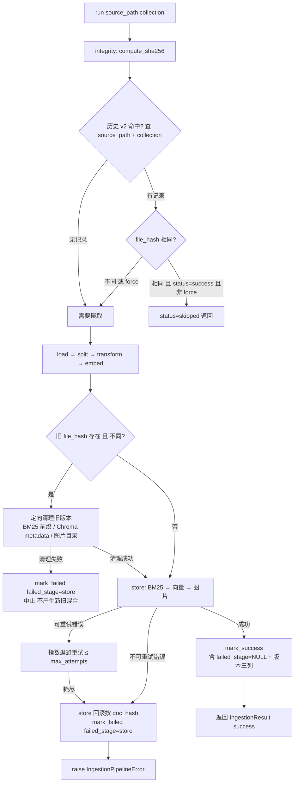

<!-- 扩展规格：摄取管线健壮性（增量判定 / 版本替换 / 同步模式 / 重试诊断 / 通用格式 / Markdown 摄取）。格式与章节对齐 03_SIRCHMUNK_INTEGRATION_SPEC_frozen.md；基线为「阶段 A–I 已完成 + S 系列 S0–S4 已交付收口」状态。 -->

# 摄取管线健壮性规格 (INGESTION_ROBUSTNESS_SPEC)

> **📌 冻结记录**
>
> - 冻结时间：2026-10-07（v1.1 冻结——IR0–IR7 全部交付收口，移入 docs/frozen/，重命名为 04_INGESTION_ROBUSTNESS_SPEC_frozen.md）
> - 2026-10-07：v1.1 IR7（M6 Markdown 摄取）交付完毕——MarkdownLoader、`.md` 双登记转正、source_filters 目录过滤、幂等集成与 vault E2E（1564 passed / 3 skipped）；IR7 收口时的唯一 e2e 失败（markitdown 0.1.8 对畸形 PDF 字节透传）已随后由 7df2893 修复，修复后全量离线 0 failed。实现观察见 IR7.5 行注。
> - 2026-10-07：v1.1 重新打开——承接 [OBSIDIAN_RAG_SPEC](../backlog/OBSIDIAN_RAG_SPEC_backlog.md) M1/M2（Markdown 摄取）为本规格 M6 / 阶段 IR7，文档移入 docs/specs/ 恢复执行状态。
> - 2026-10-07：v1.0 曾冻结收口（IR0–IR6 交付完毕）——摄取历史表 v2（版本三列 + `failed_stage`）、SHA256 增量判定与版本替换、`--sync` / `--prune` / `--dry-run` CLI、可重试错误退避 + `--retry-failed`、store 回滚、DOCX/PPTX/XLSX/HTML 多格式 Loader；实现偏差见 7.1。

> 版本：1.1 — 重新打开，新增 M6 / 阶段 IR7（Markdown 摄取，承接 OBSIDIAN V 系列 M1/M2，任务编号 IR7.x 续编）
>
> 1.0 — IR0–IR6 全部交付收口（2026-10-07），实现偏差见 7.1
>
> 0.1 — 由路线图 6.2「数据摄取」立项为可执行规格（现状审计 + 模块设计 + 项目排期）
>
> 起源：[FUTURE_OPTIMIZATION_ROADMAP.md](../reference/FUTURE_OPTIMIZATION_ROADMAP.md) 6.2「数据摄取」（增强增量更新、删除检测、失败重试、版本元数据、阶段诊断）；v1.1 扩展起源：路线图 6.8 三方对比实验的格式前置（主链路需能摄取 `.md`）
>
> 基线：01_DEV_SPEC_frozen.md 阶段 A–I 全部完成；SIRCHMUNK_INTEGRATION_SPEC S0–S4 已交付收口（agentic 路默认关闭，与本规格无耦合）
>
> 审计日期：2026-10-06（所有 file:line 引用基于当前 `feat/sirchmunk-agentic-search` 分支）

## 目录

- 项目概述
- 核心目标与范围
- 技术选型与模块设计
- 注意事项（源码实证）
- 测试方案
- 配置变更汇总
- 项目排期
- 优点亮点与风险应对
- 参考

---

## 1. 项目概述

### 1.1 结论速览

| 问题 | 结论 |
|------|------|
| 现状可用吗？ | **单文件首次摄取链路是健壮的**（确定性 chunk_id、幂等 upsert、失败记账、trace 阶段打点均已落地），但**「同一文件的再摄取」语义存在系统性缺口**：换 collection 误跳过、改内容后旧版本残留、删除不彻底。 |
| 最严重的问题？ | **文件修改后旧版本 chunk 残留**：chunk_id 以 doc_hash（文件 SHA256）为前缀，内容一变全部 chunk_id 变化，幂等替换键失效，Chroma/BM25 同时存留新旧两个版本，检索结果被过期内容污染且无法自行恢复。 |
| 第二严重？ | **`should_skip(file_hash)` 不看 collection**：同一文件摄取到第二个 collection 会被误跳过（历史表以 file_hash 为主键，命中即跳）。 |
| 怎么修？ | 五个模块增量落地：M1 历史表 v2（主键改 `(source_path, collection)` + 版本/阶段列）→ M2 版本替换与删除修复 → M3 同步模式（`--sync`/`--prune`/`--dry-run`）→ M4 重试与诊断 → M5 通用格式 Loader（markitdown 可选依赖）。 |
| 是否破坏既有行为？ | **缺省兼容**：历史表自动迁移（旧记录保留）、全部新配置项可选且缺省关闭新行为、`--force` 之外的既有 CLI 参数零改动；drift guard 单测锁死双登记约束。 |

### 1.2 现状审计（源码实证）

> 全部结论经 2026-10-06 对当前分支源码逐一核实；file:line 相对仓库根。

**A1. `should_skip(file_hash)` 不看 collection（跨 collection 误跳过）**

- [src/libs/loader/file_integrity.py](../../src/libs/loader/file_integrity.py) `:135-141`（`SQLiteIntegrityChecker.should_skip`）：仅按 `file_hash` 查 `ingestion_history`，命中且 `status == "success"` 即返回 True；**签名与查询均无 collection 参数**。
- 表结构 `:38-44`：`file_hash TEXT PRIMARY KEY` —— 一个哈希只有一条记录，天然无法区分「同一文件在 N 个 collection 中的独立摄取状态」。
- 调用点 [src/ingestion/pipeline.py](../../src/ingestion/pipeline.py) `:244`：`skipped = not force and self._integrity_checker.should_skip(file_hash)`，携带的 `collection` 参数在此判定中缺席。
- 后果：`python scripts/ingest.py --path a.pdf --collection default` 成功后，再跑 `--collection demo` 直接 `status="skipped"`，demo 集合内查不到该文档且无任何告警。

**A2. 文件修改后旧版本 chunk 残留（幂等替换键失效）**

- chunk_id 生成 [src/ingestion/chunking/document_chunker.py](../../src/ingestion/chunking/document_chunker.py) `:67-70`：`{doc_id}_{index:04d}_{content_hash[:8]}`；而 `doc_id` 即文件内容哈希（[src/libs/loader/pdf_loader.py](../../src/libs/loader/pdf_loader.py)：`doc_hash = self._compute_sha256(...)` → `Document(id=doc_hash, ...)`）。
- 文件内容一变 → doc_hash 变 → **全部 chunk_id 变**。而 store 阶段的替换语义是「同 chunk_id 替换」（[src/ingestion/pipeline.py](../../src/ingestion/pipeline.py) `:418-419` BM25、`:424` 向量幂等 upsert），新版本的 chunk_id 与旧版本完全不相交。
- 后果：`--force` 重摄取修改过的文件后，Chroma 与 BM25 **同时存留新旧两套 chunk**；旧版本只能靠 `delete_document` 逐个手工清理，检索侧无任何机制发现并淘汰它们。

**A3. `_doc_hash_of` 只取第一个哈希（删除不彻底）**

- [src/ingestion/document_manager.py](../../src/ingestion/document_manager.py) `:336-349`（`_doc_hash_of`）：遍历 chunks，遇到**第一个**有效 `metadata.sha256` / `metadata.doc_hash` 或 chunk_id 前缀（`len >= 16`）立即 `return`。
- `delete_document` `:251-288` 按该**单一** doc_hash 清理 BM25（`:268` `remove_document`）、图片（`:276` `delete_images`）、历史表（`:280` `remove_record`）。
- 后果：A2 造成新旧版本并存时，`get_by_metadata` 返回的 chunks 混含两代哈希，`_doc_hash_of` 只命中其一——另一代的 BM25 postings、图片目录、历史记录全部残留。

**A4. 没有删除检测、没有重试、没有版本元数据**

- 删除检测：`pipeline.run` 只处理显式传入的路径（[src/ingestion/pipeline.py](../../src/ingestion/pipeline.py) `:207`）；源文件从磁盘删除后，Chroma/BM25/图片/历史表中的数据**永久滞留**，无任何机制发现。
- 重试：`run` 内任一阶段异常经 `_stage` 包装（`:502-511`）后直接 `raise`（`:365-368`），CLI 侧逐文件记录失败后继续（[scripts/ingest.py](../../scripts/ingest.py)），但**失败文件没有任何自动/半自动重试通道**，只能整目录重跑。
- 版本元数据：历史表只有 `file_hash / file_path / status / processed_at / error_msg` 五列（[src/libs/loader/file_integrity.py](../../src/libs/loader/file_integrity.py) `:38-44`）——换 parser、调 chunk 策略、换 embedding 模型后，**没有任何记录区分哪些文档是用旧版本产物**，全量重建与否只能凭记忆。

**A5. 历史表没有 `failed_stage`**

- 失败发生时，阶段名只存在于异常属性与 trace 打点（[src/ingestion/pipeline.py](../../src/ingestion/pipeline.py) `:513-534` `_record_failure`：`trace.record_stage("error", ...)` + `mark_failed(file_hash, f"{type(exc).__name__}: {exc}")`）；`error_msg` 里没有结构化的阶段字段。
- 后果：失败后想知道「坏在 load 还是 embed 还是 store」，要么翻 trace 日志，要么重跑观察——`--retry-failed` 类功能缺少按阶段分诊的数据基础。

**A6. 只支持 `.pdf`**

- [src/ingestion/pipeline.py](../../src/ingestion/pipeline.py) `:487-500`（`_resolve_loader`）：仅 `.pdf` 路由到 `PdfLoader`，其余扩展名抛 `IngestionPipelineError`。
- [scripts/ingest.py](../../scripts/ingest.py) `SUPPORTED_EXTENSIONS = frozenset({".pdf"})`，与 pipeline 的扩展名由 drift guard 单测锁死（`tests/unit/test_ingest_entry.py`）——即 AGENTS.md 的**双登记约束**，新增格式必须两处同步。

**A7. store 阶段部分失败无回滚**（M4 的动因之一）

- store 阶段三路持久化顺序执行：BM25 `add` + `save` → 向量 upsert → 图片登记（[src/ingestion/pipeline.py](../../src/ingestion/pipeline.py) `:402-455`）；中途失败（如向量维度校验失败）时，已写入 BM25 的 postings 与已落盘的图片**不会回滚**，与 Chroma 产生不一致。

---

## 2. 核心目标与范围

### 2.1 In Scope

| 模块 | 名称 | 一句话目标 |
|------|------|-----------|
| M1 | 历史表 v2 | 主键改 `(source_path, collection)`；新增 `file_hash` / `failed_stage` / parser-chunk-embedding 版本列；旧表自动迁移，数据不丢 |
| M2 | 版本替换与删除修复 | 同 `source_path` 检测到不同 file_hash 时先清理旧版本全部残留；`delete_document` 遍历该源文件的所有历史哈希 |
| M3 | 同步模式 | `--sync`（目录对比：新增/修改/删除三向同步）、`--prune`（只清删除）、`--dry-run`（只报告不写入） |
| M4 | 重试与诊断 | 可重试错误分类、指数退避、`--retry-failed`、store 阶段失败按 doc_hash 回滚 |
| M5 | 通用格式 Loader | 基于 markitdown（可选依赖）支持 DOCX/PPTX/XLSX/HTML；遵守双登记约束 |
| M6 | Markdown 摄取（v1.1 承接 OBSIDIAN M1/M2） | MarkdownLoader（Vault 感知解析器）+ `.md` 路由登记 + 目录扫描 include/exclude 规则 |

### 2.2 Out of Scope（明确不做）

- **Markdown 的富抽取增强不做**（v1.1 起）：M6 承接的 MarkdownLoader 只做结构化解析（frontmatter / wikilink / tag / embed），格式能力之外不扩展范围。
- **不做文件监听（watchdog / fswatch）**：目录变化检测统一由 M3 的显式 `--sync` 命令承载；常驻监听进程与 stdio MCP server / 离线测试纪律冲突，留作未来展望。
- **不做分布式任务队列（Celery / RQ）**：摄取仍是单机 CLI 驱动的同步流程，M4 的重试是进程内有限次退避重试，不引入 broker。
- **不做 OCR**：扫描版 PDF / 图片内文字识别不在本范围（现 `PdfLoader` 的 pypdf 路径对扫描件抽取为空文本，行为保持不变），仅在展望中提及。
- **不改检索链路**：`core/query_engine/` 全部、MCP tool 契约、CitationGenerator 零改动；M5 新格式的 chunks 走与 PDF 完全相同的 chunk → transform → embed → store 管线与 metadata 契约（`source_path` / `collection` / `sha256`）。

---

## 3. 技术选型与模块设计

### 3.1 模块改动清单

| 模块 | 文件 | 改动 |
|------|------|------|
| M1 历史 | [src/libs/loader/file_integrity.py](../../src/libs/loader/file_integrity.py) | 表 v2（见 3.2）+ 自动迁移 + `FileIntegrityChecker` 抽象方法签名扩展 |
| M1 配置解析 | [src/core/settings.py](../../src/core/settings.py) | 新增 `IngestionRetryConfig` / `IngestionVersionPolicyConfig` dataclass（可选节，缺省兼容） |
| M2 替换/删除 | [src/ingestion/pipeline.py](../../src/ingestion/pipeline.py)、[src/ingestion/document_manager.py](../../src/ingestion/document_manager.py) | store 前 `prepare_version_replacement`；`_doc_hash_of` 改为收集全部哈希；`delete_document` 遍历删除 |
| M3 同步 | [scripts/ingest.py](../../scripts/ingest.py) | `--sync` / `--prune` / `--dry-run` 参数与目录对比逻辑 |
| M4 重试 | [src/ingestion/pipeline.py](../../src/ingestion/pipeline.py)、[scripts/ingest.py](../../scripts/ingest.py) | 错误分类 + 退避重试 + `--retry-failed` + store 回滚 |
| M5 Loader | `src/libs/loader/markitdown_loader.py`（新增）、[src/ingestion/pipeline.py](../../src/ingestion/pipeline.py)、[scripts/ingest.py](../../scripts/ingest.py) | 新 Loader + 扩展名路由 + 双登记同步 |
| M6 Loader | `src/libs/loader/markdown_loader.py`（新增）、[src/ingestion/pipeline.py](../../src/ingestion/pipeline.py)、[scripts/ingest.py](../../scripts/ingest.py)、[src/core/settings.py](../../src/core/settings.py) | MarkdownLoader + `.md`/`.markdown` 路由双登记 + `ingestion.source_filters` 配置与目录扫描过滤（设计见 3.8） |
| 依赖 | [pyproject.toml](../../pyproject.toml) | optional 组登记 `markitdown`（不进主依赖） |
| 测试 | `tests/unit/test_file_integrity.py`（增量）、`tests/unit/test_ingest_retry.py`（新增）等 | 见第 5 章 |

### 3.2 M1 历史表 v2

新表结构（迁移期间旧表 `ingestion_history` 原样保留，写入切到新表后旧表改名备份）：

```sql
CREATE TABLE IF NOT EXISTS ingestion_history_v2 (
    source_path       TEXT NOT NULL,   -- 绝对路径（realpath 归一后）
    collection        TEXT NOT NULL,   -- 目标集合名
    file_hash         TEXT NOT NULL,   -- 最近一次处理的文件 SHA256
    status            TEXT NOT NULL,   -- success | failed
    failed_stage      TEXT,            -- 失败阶段（integrity/load/split/transform/embed/store）
    parser_version    TEXT,            -- Loader 解析器版本
    chunk_version     TEXT,            -- Chunk 策略版本（splitter + chunk_refiner 参数摘要）
    embedding_version TEXT,            -- Embedding 模型标识（provider + model + 维度）
    processed_at      TEXT NOT NULL,
    error_msg         TEXT,
    PRIMARY KEY (source_path, collection)
);
```

- **判定语义变更**：`should_skip(file_hash)` 拆为 `should_skip(source_path, collection, file_hash)`——同路径同集合且哈希未变才跳过；换 collection / 内容变更均不再命中。抽象基类（[src/libs/loader/file_integrity.py](../../src/libs/loader/file_integrity.py) `:43` `FileIntegrityChecker`）同步改签名，注入的 fake 一并更新。
- **自动迁移**：打开数据库时检测旧表是否存在（按表名/列集判断）；存在则逐行拷入 v2（`source_path` 取旧 `file_path`，`collection` 填 `default`，版本三列置 `legacy`，`failed_stage` 置 NULL），完成后旧表重命名为 `ingestion_history_legacy_backup`。迁移失败（磁盘只读等）→ 报错退出，不静默降级。
- **版本三列**由 M1 顺带定义、由写入方填充：pipeline 在 `mark_success` / `mark_failed` 时传入当次运行的 parser/chunk/embedding 版本标识（从 `settings` 推导，规则见第 6 章）。

### 3.3 M2 版本替换与删除修复

- **版本替换**：pipeline 在 integrity 阶段判定「需要摄取」后、store 之前，按 `(source_path, collection)` 查历史 `file_hash`；若存在**且不同于当前哈希**，先执行一次定向清理（复用 `DocumentManager` 的三路删除：按旧 doc_hash 前缀清 BM25、按 `metadata.sha256 == 旧哈希` 清 Chroma、按 doc_hash 清图片目录），再走正常 store。清理失败 → 记 `failed_stage="store"`（替换前置阶段）并中止本次摄取，不产生新旧混合状态。
- **`_doc_hash_of` 修复**：改为 `_doc_hashes_of(chunks) -> set[str]`，收集全部去重哈希（metadata 两键 + chunk_id 前缀一并收），`delete_document` 对**每个**哈希执行 BM25 / 图片 / 历史表清理，返回值聚合各哈希的删除计数；Chroma 侧本就按 `(source_path, collection)` 删，天然覆盖两代。`DocumentInfo.doc_hash` / `DocumentDetail.doc_hash` 等单值消费点取 `sorted(hashes)[0]` 并在 docstring 注明口径，历史表 v2 上线后以历史表为准。
- **历史清理**：`remove_record` 按 `(source_path, collection)` 删（v2 主键），替换成功后旧 `file_hash` 自然被覆盖，不再按哈希删记录。

### 3.4 M3 同步模式

新增到 [scripts/ingest.py](../../scripts/ingest.py)（三者互斥，均针对「目录 vs 存储态」的对比）：

| 参数 | 行为 |
|------|------|
| `--sync` | 扫描目录 → 逐文件比对（路径不在历史 → 新增摄取；路径在历史且哈希不同 → 版本替换摄取；哈希相同 → 跳过）→ 目录中已消失的路径 → 触发删除检测清理 |
| `--prune` | 只做第三步：对存储中存在、目录中已消失的 `(source_path, collection)` 执行删除检测清理，不摄取任何文件 |
| `--dry-run` | 与 `--sync`/`--prune` 组合使用：完整执行对比逻辑，但**只打印计划动作**（ingest/replace/skip/prune 各自的路径清单），不写任何存储 |

- 对比基准以**历史表 v2 + 各存储反查**为准：Chroma 按 `metadata.source_path`、BM25 按 chunk_id 前缀、图片按 doc_hash 目录——不信任任何单一存储（对齐第 4 章一致性注意）。
- 删除动作与 `DocumentManager.delete_document` 共用同一实现（不另写第二套清理逻辑），保证语义一致。
- 扫描范围遵守 `SUPPORTED_EXTENSIONS`（M5 后含新增扩展名）；符号链接按既有摄取纪律不做 realpath 展开（与 `collect_files` 现行为一致）。

### 3.5 M4 重试与诊断

- **错误分类**（新增 `src/ingestion/errors.py` 或并入 pipeline 模块，落点 IR4 定）：
  - **可重试**：embedding/LLM 网络超时、连接拒绝、HTTP 5xx、SQLite `busy_timeout` 触发——特征是「同一输入重跑可能成功」；
  - **不可重试**：文件不存在/解析器崩溃（load）、维度不匹配校验失败（store）、配置非法——重跑结果确定。
  - 分类依据优先用异常类型与 `stage` 属性，embedding 后端的 HTTP 错误按既有 `httpx` 异常类型映射；分类表用参数化单测锁死。
- **指数退避**：默认 `max_attempts=3`、初始间隔 2s、倍增系数 2（`2s → 4s → 8s`，抖动 ±20%）；仅对可重试错误生效，重试耗尽后按原语义 `raise` 并 `mark_failed`（含 `failed_stage`）。
- **`--retry-failed`**：CLI 新参数，扫描历史表 v2 中 `status="failed"` 的记录，逐条重摄取；`failed_stage` 非空时在日志中标注「重试从 N 号阶段失败的历史记录」（实现上仍是整文件重跑——pipeline 无阶段断点续传，见第 4 章）。
- **store 回滚**：store 阶段失败时按当前 doc_hash 执行定向清理（BM25 前缀删除 + Chroma 按 metadata 删除 + 图片目录删除），使三路存储回到「该文档不存在」的一致状态；回滚同样失败则记录 `error_msg` 保留现场，不抛出二次异常掩盖原始错误。

### 3.6 M5 通用格式 Loader（markitdown，可选依赖）

- 新增 `src/libs/loader/markitdown_loader.py`（IR5.1 落地时创建）：实现 `BaseLoader` 契约（`load(path) -> Document`），内部调 `markitdown.MarkItDown().convert(path)` 取纯文本；`Document.id` 沿用内容 SHA256（对齐 `PdfLoader`），metadata 约定 `source_path` / `doc_type`（docx/pptx/xlsx/html）/ `sha256`（无图片抽取，`image_refs` 恒空）。
- **可选依赖**：`markitdown` 登记到 [pyproject.toml](../../pyproject.toml) optional 组（如 `[project.optional-dependencies] ingest-formats`）；`_resolve_loader` 路由到该扩展名而依赖未安装时，抛带安装指引的 `IngestionPipelineError`（`stage="load"`），**不在模块 import 期触发**，保证主依赖零新增、未装依赖时其余功能零影响。
- **双登记约束**：`.docx/.pptx/.xlsx/.html` 同时登记进 `pipeline._SUPPORTED_EXTENSIONS` 与 `scripts/ingest.py` `SUPPORTED_EXTENSIONS`，drift guard 单测（`tests/unit/test_ingest_entry.py`）自动锁死两处一致；`.pdf` 之外新增 `.md`/`.markdown` **显式排除**（Out of Scope，归 V 系列）。〔v1.1 注：`.md` 排除已由 M6（3.8）取代，IR7 落地时登记并翻转断言〕
- 图片/表格的富抽取（如图表转描述）不做——M5 只做「文本可检索」的一等目标，与 agentic 侧 rg/rga 的原生抽取兜底定位互补。

### 3.7 核心流程图（integrity 判定与版本替换）



### 3.8 M6 Markdown 摄取（v1.1 承接 OBSIDIAN_RAG_SPEC M1/M2）

> 设计全文自 [OBSIDIAN_RAG_SPEC](../backlog/OBSIDIAN_RAG_SPEC_backlog.md) 3.1/3.2 迁移而来，后续以本节为准；该规格仅保留 M3/M4。

#### 3.8.1 MarkdownLoader（Vault 感知解析器）

**新增文件**：`src/libs/loader/markdown_loader.py`（参考 `pdf_loader.py` 的实现模式与降级风格）

**接口契约**（对齐 `BaseLoader`）：

```python
class MarkdownLoader(BaseLoader):
    def __init__(self, *, vault_root: str | None = None,
                 images_root: str | None = None) -> None: ...
    def load(self, source: str) -> Document: ...
```

- `vault_root`：解析 `![[image.png]]` / `` 相对引用的根目录；缺省按 `source` 所在目录解析。
- `images_root`：图片落盘根目录，对齐 DEV_SPEC C3/C13 的 `ImageStorage.images_root` 约定。

**解析管线（有序，逐段降级不阻塞）**：

1. **读取**：UTF-8 读全文；编码错误抛可读 `LoaderError`（不静默替换）。
2. **YAML frontmatter**：文件以 `---` 行开头时提取至下一个 `---` 行；用简单行级解析（`key: value`、`key: [a, b]`、多行 `- item` 列表）优先零新依赖；环境内已有 PyYAML（chromadb 传递依赖）时可用其解析。**解析失败降级**：frontmatter 原样拼回正文，`metadata["frontmatter_parse_error"]=true`，不阻塞摄取。
3. **title**：`frontmatter.title` > 正文首个 `# H1` > 文件名 stem，三级兜底保证非空。
4. **heading_outline**：收集全部 ATX 标题行（`#`~`######`），供定位与回溯。
5. **行内 tags**：匹配 `(^|\s)#([\w\u4e00-\u9fff][\w\u4e00-\u9fff/-]*)`（排除标题行与代码块内），与 frontmatter `tags` 合并 → `metadata["tags"]`（去重保序）。
6. **wikilinks**：`[[target]]` / `[[target|alias]]` → 正文替换为 `alias 或 target`（去掉双方括号，保留可检索语义、消除 token 噪音），`target` 记入 `metadata["wikilinks"]`（去重保序）。
7. **嵌入引用 `![[target]]` 与 ``**：
   - 目标为图片扩展名（png/jpg/jpeg/gif/webp/svg/bmp）→ 按 `vault_root` 解析路径；**存在**：生成 `image_id`（沿用 `make_image_id` 语义）+ `[IMAGE: {image_id}]` 占位符 + `ImageRef` 落盘 `images_root`（对齐 C3 约定）；**不存在**：保留原文并记入 `metadata["missing_image_refs"]`，告警不阻塞。
   - 目标为笔记（`![[note.md]]`）：**不递归展开**，保留文本引用并记入 `metadata["embeds"]`（防止索引体积失控与环引用）。
8. **doc_type**：`metadata["doc_type"] = "markdown"`；无 `page` 字段（不适用）。

**输出 metadata 契约**（在 PDF 基础字段之上扩展）：

| 字段 | 类型 | 说明 |
|------|------|------|
| `source_path` | str | 绝对路径 |
| `doc_type` | str | 固定 `"markdown"` |
| `sha256` | str | 文件指纹（与 C2 同算法） |
| `title` | str | 三级兜底非空 |
| `heading_outline` | list[str] | 标题行列表 |
| `tags` | list[str] | frontmatter + 行内合并 |
| `wikilinks` | list[str] | 出链目标（文件名，不含扩展名） |
| `embeds` | list[str] | 笔记嵌入引用（未展开） |
| `images` | list[ImageRef] | 图片引用（对齐既有六字段规范） |

**确定性**：同输入同输出（无随机性、无时间戳入 metadata）；单图失败降级不阻塞整体（对齐 C3 语义）。

#### 3.8.2 路由登记与目录扫描/排除规则

**路由登记（两处同步，drift guard 锁死）**：

- [src/ingestion/pipeline.py](../../src/ingestion/pipeline.py)：`_SUPPORTED_EXTENSIONS` 追加 `{".md", ".markdown"}`；`_resolve_loader()` 新增分支 `suffix in {".md", ".markdown"}` → `MarkdownLoader(vault_root=..., images_root=str(self._image_storage.images_root))`。
- [scripts/ingest.py](../../scripts/ingest.py)：`SUPPORTED_EXTENSIONS` 同步追加（drift guard 单测自动约束两处一致）。
- IR5 交付时 drift guard 对 `.md` 的「显式排除」断言随本模块落地**转正翻转**（改为断言两处均含 `.md`），不放松一致性约束。

**目录扫描与排除（`collect_files` 扩展）**：

- 新增配置节 `ingestion.source_filters`（见第 6 章）：
  - `include_patterns: list[str]`（glob，空列表 = 全部受理）
  - `exclude_patterns: list[str]`（glob，默认 `[".obsidian/**", ".trash/**", "templates/**"]`）
- **匹配语义**：对「扫描根目录」的 POSIX 相对路径做 `fnmatch` 匹配（目录段参与匹配，如 `.obsidian/attachments/x.png` 命中 `.obsidian/**`）；include 与 exclude 同时命中时 **exclude 优先**。
- **作用范围**：过滤仅作用于**目录递归扫描**；`--path` 显式指向单个文件时视为用户明确意图，**不过滤**（仅当扩展名不支持时维持现有 usage 报错）。
- **CLI 汇总**：`IngestSummary` 新增 `filtered` 计数；汇总块输出 `filtered: N (excluded by source_filters)`；被过滤文件不出现在逐文件行中。
- **配置校验**：`include_patterns` / `exclude_patterns` 必须为 `list[str]`（元素非空字符串），否则 `ConfigError` 可读报错；空 glob 串拒绝。
- **与 M3 同步模式的交互**：`--sync` / `--prune` 的目录对比遵守同一套过滤规则（被过滤路径视为不存在，已入库的此类路径按既有 `--prune` 语义清理）。

---

## 4. 注意事项（源码实证）

### 4.1 迁移兼容

- 旧库 `data/db/ingestion_history.db` 中既有记录必须无损迁入 v2（`file_path` → `source_path`，collection 统一 `default`）；迁移逻辑要有单测覆盖「旧表存在含失败记录」「旧表不存在（全新安装）」「v2 已存在（二次启动）」三种初始状态。
- 迁移期间**不锁写**：SQLite 单文件库，迁移在连接建立时同步完成（毫秒级），不做后台迁移。
- 回滚路径：迁移是纯新增（旧表改名保留），出问题手工把 `_legacy_backup` 表名改回即回滚；不提供自动回滚命令（避免双写歧义）。

### 4.2 四个存储之间的一致性

- Chroma / BM25 / 图片 SQLite / 历史表**没有跨库事务**：任何「先删后写」的顺序都可能在中途失败后留下部分状态。M2/M4 的所有清理与回滚都必须做到**可重入幂等**（重复执行结果一致），并按固定顺序执行（BM25 → Chroma → 图片 → 历史表，历史表最后——它是「是否存在」的判定基准，提前删会让中断后的重跑误判为新增）。
- BM25 索引是**单文件全量内存态 + 整体 save**（[src/ingestion/storage/bm25_indexer.py](../../src/ingestion/storage/bm25_indexer.py)），删除后必须 `save()` 才持久化；既有代码在 save 失败时仅告警不回滚（[src/ingestion/document_manager.py](../../src/ingestion/document_manager.py) `:271-274`），M2 沿用该语义并在 docstring 注明。
- 历史表 v2 的 `(source_path, collection)` 主键是「存储里应该有什么」的**唯一权威**；Chroma 反查是软校验，两者冲突时以历史表为准并告警（不对齐时以 M3 `--sync` 修复）。

### 4.3 双登记约束与 drift guard

- M5 新增扩展名必须同步 `pipeline._SUPPORTED_EXTENSIONS` 与 `scripts/ingest.py` `SUPPORTED_EXTENSIONS` 两处，drift guard 单测失败即 CI 拦截；`.md` 不登记（2.2）。〔v1.1 注：M6/IR7 落地后 `.md`/`.markdown` 转为登记，断言同步翻转〕
- CLI 帮助文本（`build_parser` 的 epilog）中的扩展名清单从常量推导，不再手写第二份。

### 4.4 stdout 纪律

- M3/M4 的 CLI 输出走既有 `emit` 通道（[scripts/ingest.py](../../scripts/ingest.py)）；`--dry-run` 的计划报告格式必须是**人类可读多行文本**（与现有 summary 渲染一致），不得引入 JSON-RPC 形态混淆——MCP server 的 stdout 纪律（只输出合法 JSON-RPC）不受本规格影响，摄取链路不进 MCP stdio 进程。

### 4.5 Embedding 维度不一致 fail-fast

- 换 embedding 模型（维度变化）后对旧 collection 增量摄取，会导致同一语义空间内新旧向量维度混存、检索不可用。处置：`VectorUpserter` 现有的维度校验（[src/ingestion/storage/vector_upserter.py](../../src/ingestion/storage/vector_upserter.py) `:229-246`）保持 fail-fast 不变；M1 的 `embedding_version` 列让该场景**可发现**——`--sync` 检测到「历史 embedding_version ≠ 当前配置」时按 `version_policy` 决定行为（第 6 章：默认 `stale` 记录告警 + 跳过，`rebuild` 提示需全量重建，不做自动重建）。

---

## 5. 测试方案

延续 DEV_SPEC 第 4 章分层纪律：**单元/集成测试零网络、零真实模型**，外部依赖一律注入 fake（fake `FileIntegrityChecker` / fake embedding 后端 / `tmp_path` SQLite）。

| 层 | 对象 | 策略 |
|----|------|------|
| Unit | M1 | 历史表 v2：三种初始状态迁移（旧表含 success/failed 记录 / 全新安装 / 二次启动）；`should_skip` 判定矩阵（同路径同集合哈希同 → True；换 collection / 哈希变 / force → False）；版本三列写入 |
| Unit | M2 | `_doc_hashes_of` 多哈希收集；`delete_document` 遍历删除（fake store 预置两代哈希，断言 BM25/图片/历史全部清除）；版本替换前置清理失败即中止 |
| Unit | M3 | 目录对比逻辑参数化：新增/修改/删除/未变四态 × `--dry-run` 只读断言（fake checker + fake store，断言无写入调用） |
| Unit | M4 | 错误分类表参数化（可重试/不可重试各 ≥3 类）；退避序列（fake 时钟，断言 2s/4s/8s 与抖动界）；store 回滚幂等（连续两次回滚结果一致） |
| Unit | M5 | markitdown fake（monkeypatch `MarkItDown.convert`）：四扩展名路由、metadata 契约、依赖缺失时错误信息含安装指引、drift guard（`.md` 不在清单） |
| M6 | MarkdownLoader：frontmatter 三级 title 兜底、tags 合并去重、wikilink 替换与出链收集、embed 图片存在/缺失两路、坏 frontmatter 降级不阻塞、确定性（同输入两次 load 相等）；source_filters：glob 匹配语义（目录段参与）、include 空全受理、exclude 优先、默认排除生效、显式单文件不过滤、非法配置 fail-fast、filtered 计数（参数化 pattern×path 矩阵） |
| Integration | 管线全链路 | fake embedding + `tmp_path`：文件修改 → 重摄取 → 断言 Chroma/BM25 无旧版本 chunk（A2 回归）；双 collection 同文件互不跳过（A1 回归）；store 中途失败注入 → 回滚后三存储一致（A7 回归） |
| E2E / 门控 | CLI | `scripts/ingest.py --sync --dry-run` 子进程冒烟（离线 fixture 目录）；无新增网络门控 |

回归红线：既有 `tests/`（约 1273 passed / 3 skipped）零回归；drift guard 单测语义随 M5 扩展同步更新但不放松（两处清单仍必须相等）。

**M6 测试夹具**（自 OBSIDIAN_RAG_SPEC 4.1 迁移，IR7 落地时创建 `tests/fixtures/vault/` 最小 vault）：

```
tests/fixtures/vault/
├── .obsidian/app.json              # 应被默认 exclude 过滤
├── templates/daily.md              # 应被默认 exclude 过滤
├── notes/
│   ├── frontmatter.md              # 完整 YAML frontmatter（title/tags/aliases）
│   ├── wikilinks.md                # [[note]] / [[note|alias]] / ![[note.md]]
│   ├── inline-tags.md              # 行内 #tag 中文英文混合
│   ├── embeds-image.md             # ![[assets/pic.png]] + （含存在与缺失两种）
│   ├── bad-frontmatter.md          # 非法 YAML → 降级路径
│   └── 中文笔记.md                  # CJK 内容 + CJK 标签
└── assets/pic.png                  # 1x1 PNG
```

---

## 6. 配置变更汇总

`config/settings.yaml` 的 `ingestion` 节下新增两个可选子节（全部字段可选，缺省即维持现状）：

```yaml
ingestion:
  # ……既有 chunk_refiner / metadata_enricher / image_captioner / batch_size 不变……

  source_filters:              # M6：目录扫描 include/exclude（v1.1 承接 OBSIDIAN；缺省默认排除 Obsidian 噪音目录）
    include_patterns: []       # glob 列表；空 = 全部受理
    exclude_patterns:          # glob 列表；优先于 include
      - ".obsidian/**"
      - ".trash/**"
      - "templates/**"

  retry:                       # M4：失败重试（缺省 = 不重试，行为与基线一致）
    max_attempts: 1            # 1 = 关闭重试；>1 时仅可重试错误走退避
    initial_backoff_s: 2.0     # 首次退避间隔
    backoff_multiplier: 2.0    # 倍增系数
    backoff_jitter: 0.2        # 抖动比例（±20%）

  version_policy:              # M1/M3：版本元数据与不兼容检测
    parser_version: auto       # auto = 从 Loader 实现推导；可显式覆盖字符串
    chunk_version: auto        # auto = splitter 类型 + chunk_size/overlap 摘要
    embedding_version: auto    # auto = provider + model + 维度
    on_embedding_mismatch: stale   # stale = 告警并跳过该文件 | rebuild = 提示需全量重建（不自动执行）
```

- 三个子节整体缺失、单字段缺失均走默认值（对齐 `AgenticSearchConfig` 的可选节纪律）；**非法值 fail-fast**（`max_attempts < 1`、`backoff_multiplier <= 1`、未知 `on_embedding_mismatch` 枚举值；`include_patterns` / `exclude_patterns` 非 `list[str]`、元素非非空字符串、空 glob 串均拒绝）。
- v1.1 起新增 `source_filters` 子节；缺省 `exclude_patterns` 与 OBSIDIAN 场景对齐（`.obsidian/**`、`.trash/**`、`templates/**`），不使用 Obsidian 的项目可整节删除恢复「全受理」基线。
- 不新增数据库路径、不新增存储后端；历史表 v2 沿用 `data/db/ingestion_history.db` 单文件。

---

## 7. 项目排期

> **排期原则**（延续 DEV_SPEC 第 6 章）：1 小时一个可验收增量；每步在文件系统产生可见变化；TDD 优先；外部依赖可 Mock。
>
> **任务前缀 IR（Ingestion Robustness）**，避免与既有 A–I / V / S 编号冲突。**IR0–IR6 已收口**；v1.1 重开后新增 **阶段 IR7**（Markdown 摄取，承接 OBSIDIAN V 系列 V1–V4），按 IR7.1 → IR7.5 顺序执行。

### 阶段总览

1. **阶段 IR0**：基线锁定——现状行为固化为一组「缺陷即用例」回归测试（先让 A1–A7 以失败测试的形式存在）。
2. **阶段 IR1–IR5**：对应 M1–M5 五个模块，各自独立可验收、可合入。
3. **阶段 IR6**：文档收口与全量回归。

### 📊 进度跟踪表 (Progress Tracking)

> **状态说明**：`[ ]` 未开始 | `[~]` 进行中 | `[x]` 已完成

#### 阶段 IR0：基线锁定

| 任务编号 | 任务名称 | 状态 | 完成日期 | 验收标准 |
|---------|---------|------|---------|---------|
| IR0.1 | 现状缺陷回归测试（红） | [x] | 2026-10-07 | `tests/unit/` 新增用例覆盖 A1–A7 七项缺陷（A1 双 collection 误跳、A2 修改后旧 chunk 残留、A3 混合版本删除不彻底、A5 failed_stage 缺失、A6 扩展名单一、A7 store 部分失败不一致）；以 `xfail` 或独立文件标记，M 落地后逐个转正；既有全套件零回归；**完成**：d2de90e：`test_ingestion_robustness_baseline.py`，缺陷用例随 IR1–IR5 逐个转正 |
| IR0.2 | 历史表现状快照 | [x] | 2026-10-07 | 对现有 `data/db/ingestion_history.db` 记录行数与列集写入测试 fixture（脱敏），作为 IR1 迁移正确性的对照基线；**完成**：d2de90e：以 `test_file_integrity_v2.py` 的合成旧表 fixture（`_create_legacy_db`，含 success/failed/同路径多哈希）替代真实库快照（偏差见 7.1） |

#### 阶段 IR1：历史表 v2（M1）

| 任务编号 | 任务名称 | 状态 | 完成日期 | 验收标准 |
|---------|---------|------|---------|---------|
| IR1.1 | 表 v2 schema + 自动迁移 | [x] | 2026-10-07 | `SQLiteIntegrityChecker` 建 v2 表（3.2 结构）；三种初始状态迁移单测全绿（旧表含记录 / 全新安装 / 二次启动）；旧表改名 `_legacy_backup` 保留；迁移逻辑离线（仅 SQLite）；**完成**：d2de90e：`ingestion_history_v2` + 自动迁移（旧表改名 `ingestion_history_legacy_backup`） |
| IR1.2 | `should_skip` 签名扩展 | [x] | 2026-10-07 | 判定改为 `(source_path, collection, file_hash)`；抽象基类与全部注入 fake 同步；A1 回归测试转正（双 collection 互不跳过）；`FileIntegrityChecker` docstring 更新判定语义；**完成**：d2de90e：签名为 `should_skip(file_hash, *, source_path, collection)`（偏差见 7.1） |
| IR1.3 | `failed_stage` + 版本三列 | [x] | 2026-10-07 | `mark_success` / `mark_failed` 接受 `failed_stage` 与三个版本参数（pipeline 从 settings 推导传入）；A5 回归测试转正；版本推导规则写入 `settings.py` docstring（`auto` 口径）；**完成**：d2de90e：`resolve_ingestion_versions` 推导 `auto` 口径 |
| IR1.4 | 配置节 `retry` / `version_policy` | [x] | 2026-10-07 | `IngestionRetryConfig` / `IngestionVersionPolicyConfig` dataclass + builder；可选节缺失走默认、非法值 fail-fast 参数化单测；`config/settings.yaml` 补注释样例（第 6 章）；**完成**：d2de90e：`IngestionRetryConfig` / `IngestionVersionPolicyConfig`；`test_ingestion_config.py` |

#### 阶段 IR2：版本替换与删除修复（M2）

| 任务编号 | 任务名称 | 状态 | 完成日期 | 验收标准 |
|---------|---------|------|---------|---------|
| IR2.1 | `_doc_hashes_of` 全量收集 | [x] | 2026-10-07 | 收集 metadata 两键 + chunk_id 前缀全部去重哈希；`delete_document` 遍历清理 BM25/图片/历史并聚合计数；A3 回归测试转正（预置两代哈希的 fake store 全清）；单值消费点口径（`sorted()[0]`）写入 docstring；**完成**：3cee333：`_doc_hashes_of` + `delete_document` 遍历清理 |
| IR2.2 | 版本替换前置清理 | [x] | 2026-10-07 | pipeline integrity 判定后、store 前按旧 file_hash 定向清理（3.3 顺序）；清理失败记 `failed_stage="store"` 并中止；集成测试：文件修改 → 重摄取 → 三存储无旧版本残留（A2 回归转正）；清理顺序幂等性单测（连续两次执行结果一致）；**完成**：3cee333：`DocumentManager.prepare_version_replacement` |

#### 阶段 IR3：同步模式（M3）

| 任务编号 | 任务名称 | 状态 | 完成日期 | 验收标准 |
|---------|---------|------|---------|---------|
| IR3.1 | 目录对比 + `--dry-run` | [x] | 2026-10-07 | `collect_and_diff`：四态（新增/修改/删除/未变）判定以历史 v2 + 存储反查为基准；`--dry-run` 打印计划清单且零写入断言（fake store 记录调用）；参数化单测覆盖四态 × 组合；**完成**：cb059f1：`collect_and_diff` 五态（new/modified/unchanged/deleted/stale）+ `render_plan` |
| IR3.2 | `--sync` / `--prune` 落地 | [x] | 2026-10-07 | 删除动作复用 `delete_document` 单一实现；`--prune` 零摄取断言；扩展名清单随 M5 常量推导；子进程 E2E 冒烟（离线 fixture 目录）全绿；退出码语义沿用既有矩阵（0 成功 / 1 部分失败 / 2 用法错误，无新增）；**完成**：cb059f1：`test_ingest_sync.py`；退出码 0/1/2 不变 |

#### 阶段 IR4：重试与诊断（M4）

| 任务编号 | 任务名称 | 状态 | 完成日期 | 验收标准 |
|---------|---------|------|---------|---------|
| IR4.1 | 错误分类 + 指数退避 | [x] | 2026-10-07 | 分类表参数化单测（≥6 类，含边界：`IngestionPipelineError` 带 stage 的映射）；退避用 fake 时钟断言序列与抖动界；`retry.max_attempts=1` 时零重试（基线行为逐字节一致）；重试计入 trace（`attempt` 序号）；**完成**：cb059f1：`src/ingestion/errors.py`（`is_retryable` / `compute_backoff`，上限 30s） |
| IR4.2 | store 回滚 + `--retry-failed` | [x] | 2026-10-07 | store 失败按 doc_hash 回滚三存储，A7 回归测试转正（注入 upsert 失败 → 断言 BM25/图片无残留）；回滚自身失败仅记录不掩盖原始异常（单测）；`--retry-failed` 扫描 v2 failed 记录重跑，`failed_stage` 在日志输出；**完成**：cb059f1：`_rollback_store` + `--retry-failed`；`test_ingestion_retry.py` |

#### 阶段 IR5：通用格式 Loader（M5）

| 任务编号 | 任务名称 | 状态 | 完成日期 | 验收标准 |
|---------|---------|------|---------|---------|
| IR5.1 | `MarkitdownLoader` + 路由 | [x] | 2026-10-07 | 四扩展名（docx/pptx/xlsx/html）路由 + 依赖缺失错误含安装指引（`stage="load"`）；metadata 契约（source_path/doc_type/sha256，无图片）；fake convert 单测；`pyproject.toml` optional 组登记、主依赖零新增；**完成**：d2de90e：`markitdown_loader.py`；extra `ingest-formats`（偏差见 7.1） |
| IR5.2 | 双登记同步 + 集成 | [x] | 2026-10-07 | `pipeline._SUPPORTED_EXTENSIONS` 与 `scripts/ingest.py` 清单同步且 drift guard 全绿；`.md` 显式不在清单（断言）；端到端集成：fake markitdown 产物走完整 chunk → store 管线，与 PDF chunk 同构断言；**完成**：3cee333：`test_ingestion_loader_routing.py`；`.md` 显式排除 |

#### 阶段 IR6：收口

| 任务编号 | 任务名称 | 状态 | 完成日期 | 验收标准 |
|---------|---------|------|---------|---------|
| IR6.1 | 全量回归 + 文档收口 | [x] | 2026-10-07 | **完成**：1484 passed / 3 skipped（基线 1273 → +211 新增用例，零回归）；子进程 E2E `tests/e2e/test_ingest_cli_subprocess.py` 发现并修复 `--dry-run` 首次运行会建库落盘的问题（改走只读资源装配）。原验收：`pytest tests -q` 离线全绿（零回归 + 新增用例统计回填本表）；README「开发文档」表与 USAGE_GUIDE 增补同步格式/同步模式用法；FUTURE_OPTIMIZATION_ROADMAP 6.2 标记落地状态；本文档进度表勾完 |

#### 阶段 IR7：Markdown 摄取（M6，v1.1 承接 OBSIDIAN_RAG_SPEC M1/M2）

> 原 OBSIDIAN V 系列 V1–V4 对应本阶段 IR7.1–IR7.4；V5（sentence-transformers）与 V6（Semantic Walk）仍留在 OBSIDIAN_RAG_SPEC，与本阶段互不依赖。

| 任务编号 | 任务名称 | 状态 | 完成日期 | 验收标准 |
|---------|---------|------|---------|---------|
| IR7.1 | MarkdownLoader 基础（读取/frontmatter/title/outline，原 V1） | [x] | 2026-10-07 | `markdown_loader.py` 落地：frontmatter 行级解析优先、PyYAML 兜底（坏 YAML 降级 + `frontmatter_parse_error`）、title 三级兜底、heading_outline、doc_type=markdown、Document.id=内容 SHA256；29 个单测（`test_markdown_loader.py`）含 fixtures/vault 全笔记冒烟 |
| IR7.2 | MarkdownLoader 进阶（tags/wikilinks/embeds/图片，原 V2） | [x] | 2026-10-07 | tags 合并去重（排除标题行/代码块，中英文）；wikilink 替换 + 出链去 `.md` 扩展名入 metadata；`![[img]]`/`` 存在两路（`make_image_id` + 占位符 + ImageRef 落盘）/缺失（missing_image_refs）；`![[note.md]]` 不展开仅记 embeds；确定性单测通过。偏差：URL 图片不解析、空 Markdown 返回空 Document 不报错 |
| IR7.3 | Pipeline 路由注册 `.md`（双登记，原 V3） | [x] | 2026-10-07 | `_SUPPORTED_EXTENSIONS` 含 `.md`/`.markdown`，`_resolve_loader` 路由 MarkdownLoader（vault_root=源文件目录，不进 per-suffix 缓存——vault_root 随源变化）；drift guard 三处断言翻转（test_ingest_entry / test_ingestion_loader_routing / 基线守卫）且两处清单相等；单文件 `--path x.md` 可摄取 |
| IR7.4 | 目录扫描 include/exclude 规则（原 V4） | [x] | 2026-10-07 | `IngestionSourceFiltersConfig`（非法 fail-fast，31 用例）；`collect_files_detailed` + `_is_filtered`（fnmatch 目录段参与、exclude 优先、过滤先于扩展名筛选）；显式单文件不过滤；CLI 汇总 `filtered: N (excluded by source_filters)`；`--sync`/`--dry-run` 同语义；集成断言 fixtures/vault filtered==2 |
| IR7.5 | Markdown 摄取收口 | [x] | 2026-10-07 | **完成**：幂等集成 4 例（`test_markdown_ingest_idempotency.py`：重跑全 skipped / `--force` 幂等替换无残留 / 修改单文件仅该文件重摄取 / `--sync` 变体）；E2E 2 例（`test_markdown_vault_query.py`：CLI 摄取 → `query.py` 命中笔记路径；子进程 MCP `tools/call` citations source 为 `.md` 笔记路径）；`config/settings.yaml` 补 source_filters 注释样例；README/USAGE_GUIDE 支持格式更新。全量：1564 passed / 3 skipped（基线 1484 → +80 新增，零回归；e2e 既有失败 `test_cli_broken_pdf_maps_to_failed_file_not_crash` 系 markitdown 0.1.8 对畸形 PDF 的原始字节透传，**已随后由 7df2893 修复**，修复后全量 0 failed）。原验收中「全套件离线全绿」：达成 |

### 7.1 实现偏差 / 收口记录

> IR0–IR5 已于 2026-10-07 在 `feat/ingestion-robustness` 分支交付：d2de90e（IR0 / IR1 / IR5.1）、3cee333（IR2 / IR5.2）、cb059f1（IR3 / IR4）。以下为与第 3–6 章设计不一致之处，以代码为准。

| 设计（章节） | 实际实现 | 原因 |
|------|------|------|
| `should_skip(source_path, collection, file_hash)`（3.2） | `should_skip(file_hash, *, source_path=None, collection=None)`：`file_hash` 仍为首个位置参数，新参数 keyword-only；省略 `source_path` 时按旧语义（任一 success 哈希命中） | 兼容既有调用点与注入的 fake，避免一次性改签名 |
| `source_path` 按 realpath 归一（3.2 表注释） | 原样存储，不做 realpath；归一化由调用方负责（CLI 同步模式按 `abspath` 比较） | 与 Chroma `metadata.source_path` 的键保持一致，否则反查对不上 |
| 依赖缺失抛 `IngestionPipelineError(stage="load")`（3.6） | `MarkitdownLoader` 抛 `MarkitdownNotInstalledError`（同时是 `ImportError` 子类，含安装指引），由 pipeline `_stage` 包装为 `stage="load"` | 保持 `libs → ingestion` 单向分层，libs 层不 import ingestion 的异常 |
| 空文本处理未明确（8.2） | markitdown 抽取为空文本时抛 `MarkitdownLoaderError`，按 load 失败记 `failed_stage` | 空 Document 静默入库无法诊断 |
| 测试文件 `tests/unit/test_ingest_retry.py`（3.1） | 实际为 `tests/unit/test_ingestion_retry.py` | 与 `test_ingestion_*` 系列命名对齐 |
| IR0.2 真实库快照 | 用合成旧表 fixture（`_create_legacy_db`）覆盖迁移对照 | 本地库内容不稳定且不应入库，合成数据可确定复现 |
| 同步四态（3.4） | `collect_and_diff` 为五态：new / modified / unchanged / deleted / stale（`embedding_version` 与当前配置不同，按 `on_embedding_mismatch` 告警并跳过；迁移来的 `legacy` 版本不判 stale） | 4.5 的不兼容检测需要独立的动作分类 |

**已知遗留问题（建议后续立项）**：chunk_id 为 `{doc_hash}_{index}_{content_hash}`，不含 collection；而所有 collection 共用同一个物理 Chroma collection（BM25 / 图片同样按哈希寻址）。同一文件摄取到两个 collection 时会共享 chunk_id，后一次 upsert 会覆盖前一次的 `metadata.collection`。当前清理逻辑已有防护（哈希仍被其他 `(source_path, collection)` 引用时不清 BM25 / 图片），不会因为一个 collection 的删除或替换误删另一个 collection 的数据，但覆盖问题仍在。修复方向是把 collection 纳入 chunk_id（或 BM25 / 图片的键），需要配套数据迁移。

---

## 8. 优点亮点与风险应对

### 8.1 功能与工程亮点

1. **「缺陷即用例」先行**：IR0 把七项现状缺陷固化为失败测试，每个模块的完成标准是「让对应红测试转正」，杜绝修复引入新回归。
2. **单一权威判定基准**：历史表 v2 的 `(source_path, collection)` 主键成为「存储里应该有什么」的唯一事实源，同步/替换/重试三个模块共享同一判定，不再各说各话。
3. **幂等可重入的清理**：所有删除/回滚设计为重复执行结果一致，补偿了四存储无跨库事务的结构性限制。
4. **零破坏升级**：旧历史表自动迁移 + 全部新配置可选缺省兼容 + 主依赖零新增（markitdown 走 optional 组）。
5. **复用既有抽象**：M5 沿用 `BaseLoader` 契约与双登记纪律，M3 删除复用 `DocumentManager` 单一实现——不为新功能开第二套语义。

### 8.2 风险与应对

| 风险 | 影响 | 应对 |
|------|------|------|
| 迁移破坏既有历史记录 | 增量判定失效，全量重摄取 | 迁移对照基线（IR0.2）+ 三初始状态单测 + 旧表改名保留可手工回滚 |
| 版本替换清理误删其他文档 | 数据丢失 | 清理键全部含 doc_hash / `(source_path, collection)` 双重限定（与 `delete_document` 同键）；IR2.2 幂等单测 + 集成断言无越界删除 |
| `--sync` 对大目录扫描慢 | CLI 阻塞 | 对比逻辑 O(n) 内存索引（历史表一次性载入，对齐 `_history_index` 先例）；不做文件监听常驻进程 |
| 重试放大故障（对不可重试错误反复打） | 延迟与外部配额浪费 | 错误分类表参数化锁死；默认 `max_attempts=1` 关闭；退避带上限（`initial × multiplier^attempt` 封顶 30s） |
| markitdown 上游解析质量参差 | 抽取文本乱/空 | metadata 记 `doc_type` 便于分格式排查；空文本按 load 失败落 `failed_stage` 可诊断；富抽取不做承诺（Markdown 结构化解析见 M6/IR7） |
| 四存储状态漂移（历史与实际不符） | sync 误判 | 历史表为权威 + 存储反查软校验告警（4.2）；`--sync` 即修复工具 |
| 双登记遗漏新扩展名 | CLI 与管线行为分叉 | drift guard 单测零放松；帮助文本从常量推导 |

---

## 9. 参考

- 历史表现状：[src/libs/loader/file_integrity.py](../../src/libs/loader/file_integrity.py)（`_SCHEMA :38-44`、`should_skip :135`、`_upsert :198`）
- 管线阶段与失败记账：[src/ingestion/pipeline.py](../../src/ingestion/pipeline.py)（`run :207`、`_store :402`、`_resolve_loader :487`、`_record_failure :513`）
- 删除协调：[src/ingestion/document_manager.py](../../src/ingestion/document_manager.py)（`delete_document :251`、`_doc_hash_of :336`）
- chunk_id 生成：[src/ingestion/chunking/document_chunker.py](../../src/ingestion/chunking/document_chunker.py)（`_generate_chunk_id :67`）
- CLI 入口与双登记：[scripts/ingest.py](../../scripts/ingest.py)（`SUPPORTED_EXTENSIONS`、drift guard `tests/unit/test_ingest_entry.py`）
- 关联规格：[01_DEV_SPEC_frozen.md](01_DEV_SPEC_frozen.md)（C2 历史表 / C4 chunk_id / C11–C12 存储契约）、[03_SIRCHMUNK_INTEGRATION_SPEC_frozen.md](03_SIRCHMUNK_INTEGRATION_SPEC_frozen.md)（格式先例；agentic 路与本规格无耦合）、[OBSIDIAN_RAG_SPEC.md](../backlog/OBSIDIAN_RAG_SPEC_backlog.md)（v1.1 起其 M1/M2 Markdown 摄取由本规格 IR7 承接；该规格保留 M3/M4）
- 立项来源：[FUTURE_OPTIMIZATION_ROADMAP.md](../reference/FUTURE_OPTIMIZATION_ROADMAP.md) 6.2「数据摄取」
