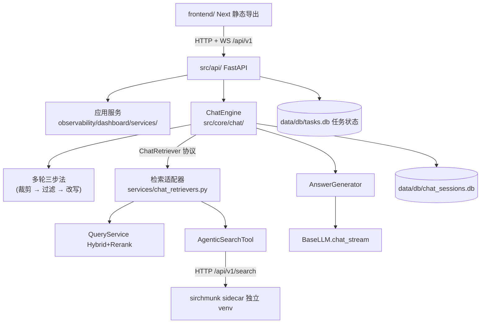
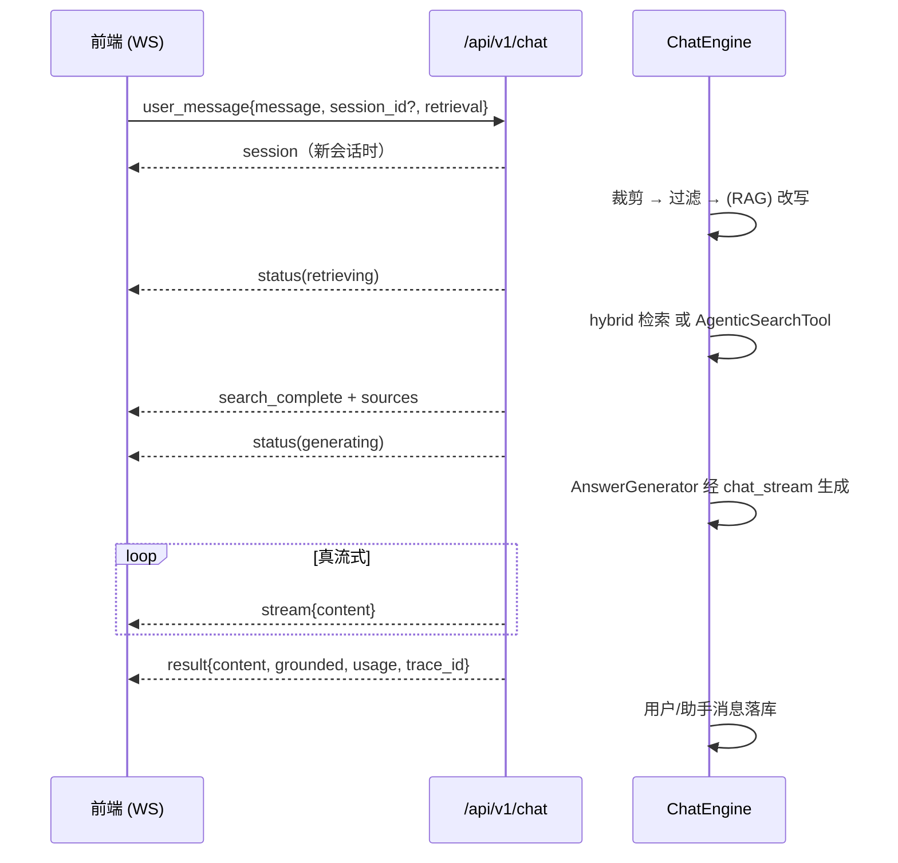

# WebUI 前后端迁移与 Chat 规格 (WEBUI_CHAT_SPEC)

> **📌 冻结记录**
>
> - 冻结时间：2026-10-15（WC0–WC10 全部交付收口，移入 docs/frozen/，重命名为 06_WEBUI_CHAT_SPEC_frozen.md）
> - 交付范围：FastAPI API 层（`src/api/`）、Next 16 静态导出前端（`frontend/`）、多轮 Chat（`src/core/chat/`，WS 真流式、有据回答、hybrid/agentic 路由）、七页面迁移、Playwright 20 流程。收口时基线：全量离线 2403 passed / 11 skipped（含 8 个门控冒烟）；vitest 246；e2e_web 20/20。
> - WC10.3 门控冒烟（2026-10-15）：Chat 4/4（DeepSeek）、agentic 4/4（真实 sidecar）。实测观察：①真实流的帧序为 session → status → search_complete → sources → status{generating} → stream×n → result，status 帧穿插在 search_complete/sources 前后，门控测试只校验非 status 帧的相对顺序；②sidecar 未带 token 时，上游 `auth_middleware` 的 401 被 BaseHTTPMiddleware 包成 HTTP 500（INTERNAL_ERROR），表象像 sidecar 内部错误，实为 `SIRCHMUNK_API_TOKEN` 未传给主项目；③DeepSeek 偶发 IncompleteRead / 排队延迟，属上游抖动，重试即过。
> - 遗留（不阻塞，见 webui-parity-followups 台账，已晋升为 [../specs/STREAMLIT_RETIREMENT_SPEC.md](../specs/STREAMLIT_RETIREMENT_SPEC.md)）：M1 Deep 进度通道、L1 sidecar 托管编排并入 start_api、`api.enabled` 默认值待定；Streamlit 保留为 legacy，删除条件见 USAGE_GUIDE §10.9。

> 状态：**已冻结**（WC0–WC10 全部交付收口，2026-10-15）｜立项日期：2026-10-14｜上游参考基线：sirchmunk `b314e11`（与 [SIRCHMUNK_EXTENSION_SPEC_frozen](05_SIRCHMUNK_EXTENSION_SPEC_frozen.md) 一致，本文 file:line 均相对 `sirchmunk/src/sirchmunk/` 与 `sirchmunk/web/`）
>
> 决策依据：[frozen/dashboard-api-migration_backlog_frozen.md](dashboard-api-migration_backlog_frozen.md)（Dashboard 迁移提案 P1–P6）、[analysis/SIRCHMUNK_WEBUI_CHAT_REUSE_ANALYSIS.md](../analysis/SIRCHMUNK_WEBUI_CHAT_REUSE_ANALYSIS.md)（WebUI/Chat 复用分析）。本规格对前者有一处选型推翻（第 3 章 D1），对后者有五处勘误（§1.2）。
>
> 红线不变：主 venv 永不 `import sirchmunk`（sidecar 只经 HTTP 访问）；MCP server 的 stdout 只输出合法 JSON-RPC；MCP tools 契约不动。

---

## 目录

- [1. 概述](#1-概述)
- [2. 范围](#2-范围)
- [3. 决策记录](#3-决策记录)
- [4. 模块设计](#4-模块设计)
- [5. 源码实证注意事项](#5-源码实证注意事项)
- [6. 测试方案](#6-测试方案)
- [7. 配置变更汇总](#7-配置变更汇总)
- [8. 排期与进度](#8-排期与进度)

---

## 1. 概述

### 1.1 背景与目标

本项目 Web 层现状是 Streamlit Dashboard（`src/observability/dashboard/`，七个页面，Python 约 1.7k 行）：单用户、与核心管线同进程直调、无认证、长任务绑定 rerun。两条已知演进线合并立项：

1. **前后端分离迁移**（`dashboard-api-migration_backlog_frozen.md` 的 P1–P6 实施包，原 backlog 提案已随本规格收口移入 frozen/）；
2. **Chat 功能**（多轮对话 + RAG 有据回答），backlog 提案未覆盖的新能力。

上游 sirchmunk 自带完整的 WebUI + Chat 实现（FastAPI + WebSocket 后端、Next.js 静态导出前端、单端口托管），可移植其**模式与前端代码**（Apache-2.0）；其**后端不可照抄**——API 层与搜索引擎同进程直连，本项目对应通道是 `src/libs/agentic_search/http_backend.py`。

两条线合并为一个规格、分阶段交付：迁移阶段（WC1–WC4、WC9、WC10）与 Chat 阶段（WC5–WC8）之间有三个耦合点——WC1.6 的 `QueryService`（Chat 的 hybrid 检索）、WC2 的 API 骨架（Chat WS 端点）、WC3.1 的前端脚手架（Chat 前端）；WC5 不依赖迁移线，可提前推进。

### 1.2 对分析文档的勘误（SIRCHMUNK_WEBUI_CHAT_REUSE_ANALYSIS）

分析结论大方向成立，但逐条复核本项目与上游源码（`b314e11`）后有五处修正，模块设计按修正后的结论编写：

1. **主链路没有 LLM 生成步骤**。分析建议「主 RAG 路径 LLM 调用改造为生成器风格」，但本项目主 RAG 路径根本没有该调用：`ResponseBuilder`（`src/core/response/response_builder.py`）只把检索结果渲染为引用 Markdown，答案生成由 MCP Host Agent 承担。因此 Chat 需要**新增**有据回答生成器（`AnswerGenerator`，§4.5）；`ResponseBuilder` 与 MCP tools 一律不改。
2. **LLM 层不具备流式能力**。`BaseLLM` 只有同步 `chat()`（`src/libs/llm/base_llm.py`）；`OpenAICompatibleLLM` 用 stdlib `urllib` 一次性读响应；Ollama 后端写死 `"stream": False`（`src/libs/llm/ollama_llm.py:100`）。真流式需新增可选 `chat_stream()`（§4.4），上游 sirchmunk 的 `llm.achat(stream=True)` 不可移植。
3. **前端版本是 Next ^16.1.1 / React 19**，不是分析文档写的 Next.js 14（`web/package.json:20-21`）。Chat 的 WS 消费逻辑在 `web/context/GlobalContext.tsx:640-930`，不在 `useQuestionReducer.ts`；其消费的日志帧类型是 **`search_log`** 而非 `log`（`log` 是 question WS 的帧）。
4. **`sources.rag[0].relevance_score: 0.92` 是硬编码**（`api/chat.py:904`，RAG+Web 模式 `:1063` 另有一处），非真实评分。列入「不抄」清单：Chat 的 sources 直接渲染 citations（`CitationGenerator` 产物，含真实 score）。
5. **多轮三步法的触发条件不对称**：话题相关性过滤每轮执行（`chat_websocket` 对非空 history 恒调用，`chat.py:1206-1213`）；查询改写只在 RAG 模式下执行（`_chat_rag` 内，`chat.py:876`；RAG+Web 模式 `:1033` 同款），纯聊天模式不改写也不需要。设计照此保持。

另有一条边界修正：上游 chat WS 的 `log` 类消息经 `LogCallbackManager.create_search_log_callback` 发送时帧类型实为 `search_log`（`chat.py:398-460`），`web/context/GlobalContext.tsx:719` 按 `search_log` 消费。移植前端时按本规格 §4.7 的帧协议对齐。

---

## 2. 范围

### 2.1 In Scope

| 期 | 模块 | 一句话目标 |
|----|------|-----------|
| WC0 | 决策落档与基线 | 本规格落档、依赖与工具链锁定、基线测试固化 |
| WC1 | P1 服务边界 + QueryService | 页面业务编排移入应用服务；新增 Hybrid 检索服务封装 |
| WC2 | P2 FastAPI 骨架 + 只读接口 | `src/api/` 落地：鉴权、错误格式、健康检查、只读资源路由 |
| WC3 | P3 Next 前端 + 只读页面 + 单端口托管 | 静态导出前端工程、三只读页、FastAPI 托管与 SPA 回退 |
| WC4 | P4 写接口 + 任务模型 | 上传/删除/摄取/评估接口、SQLite 任务状态、WS 任务事件 |
| WC5 | LLM 流式 + AnswerGenerator | `BaseLLM.chat_stream`、SSE/NDJSON 解析、有据回答生成 |
| WC6 | Chat 核心 | 多轮三步法、SessionStore（SQLite）、ChatEngine 编排 |
| WC7 | Chat WS 端点 + 会话 REST | `/api/v1/chat` 帧协议、会话管理路由、检索模式路由 |
| WC8 | Chat 前端 | 移植 Chat UI 与上下文、citations 面板、模式选择器 |
| WC9 | P5 剩余页面迁移 | Data Browser、Ingestion 管理、评估面板、Query Playground + Playwright |
| WC10 | P6 双轨验收与收口 | 功能等价核验、Streamlit 退役、门控冒烟、文档同步 |

### 2.2 Out of Scope（明确不做）

- **Web 搜索模式**：上游 Mode 3/4 的 `_perform_web_search` 是 mock（`chat.py:681`），无真实实现可移植，也不在本项目需求内。
- **tkinter 文件选择器**（`chat.py:238-678`）：macOS Cocoa 崩溃对话框等平台问题随平台绑定而来，Web 端用浏览器原生文件上传。
- **DuckDB / HistoryStorage**：主项目存储栈是 SQLite（摄取历史已用），不为此引入 DuckDB。会话存储自建 SQLite 两表（§4.5）。
- **同进程 `import sirchmunk`**：进程隔离红线（SIRCHMUNK_INTEGRATION_SPEC 第 4 章），agentic 检索只经 `AgenticSearchTool` → HTTP。
- **假流式**：上游 `stream` 帧逐词 + `sleep(0.05)`（`chat.py:1245-1262`）不移植；本规格 Chat 的流式一律真流式（LLM token 流或 sidecar 原生进度）。
- **sirchmunk 的 knowledge / monitor / graph / settings 页面**：sirchmunk 产品层，Dashboard 已有对应职能（能力对照见 SIRCHMUNK_CAPABILITY_GAP_ANALYSIS）。
- **多用户、认证体系、审计**：沿用「单 token 静态鉴权」粒度（§4.2），不做用户表/角色。
- **多轮对话质量评估**（过滤/改写的命中率度量）：有价值但无法在立项时回答「如何确认有效」，按 backlog 约定记入候选池，不在本规格。
- **MCP tools / ResponseBuilder / query_engine 主链路改动**：Chat 是叠加层，不触碰既有 MCP 契约与 stdout 纪律。
- **`relevance_score` 硬编码**（§1.2 第 4 条）。

---

## 3. 决策记录

| 编号 | 决策 | 理由与影响 |
|------|------|-----------|
| D1 | **前端：React + Next 静态导出**（对齐上游 `web/`），推翻 backlog 提案的 Vue 3 | 用户拍板。可直接移植 sirchmunk `web/` 的 Chat UI、主题、markdown 渲染链（ReactMarkdown + KaTeX + Mermaid，`web/package.json`），前端迁移成本最低。backlog 文档保留作决策依据，其 Vue 选型段落由本条覆盖 |
| D2 | **传输：Chat 用 WebSocket**；后台任务进度也用 WS 并共用帧信封；另提供 `GET /api/v1/tasks/{id}` 轮询作为断线恢复 | 用户拍板，对齐上游。与 SX5 的「主项目 → sidecar 用 SSE」不冲突：那是服务间调用，本项目对外客户端统一 WS。backlog P4 原拟 SSE，按本条修订 |
| D3 | **范围：合并规格**，迁移 P1–P6 与 Chat 分阶段，任务编号 WC 统一 | 用户拍板。迁移与 Chat 共享 API 层、鉴权、任务模型，拆开会导致两份规格交叉引用同一批文件 |
| D4 | **检索：Chat 每轮可选 `hybrid`（默认）/ `agentic_fast` / `agentic_deep`** | 用户拍板。hybrid 走主链路（毫秒级、零 token）；agentic 走 `AgenticSearchTool`（复用其 PathGuard/trace/参数校验），DEEP 继续受 `allow_deep` 门控（SX 系列语义不变） |
| D5 | API 路由前缀统一 `/api/v1` | 与上游习惯及本项目既有 sidecar 端点（`/api/v1/search`）一致，前端移植时路径改动最小 |
| D6 | Chat 降级策略：检索失败默认发 `error` 帧；仅当 `chat.fallback_to_chat_only: true` 才降级纯聊天，且 `result.grounded: false` 显式标记 | 守「引用必须可溯源」纪律（与 SX2 恒发 `llm_fallback: false` 同一原则）；上游无条件的纯聊天降级（`chat.py:928-937`）不照抄 |
| D7 | Trace 不新增 `trace_type`：Chat 每轮写**恰好一条** `query` trace，trace 级标识用 `metadata.routes="chat"`（另记 `metadata.retrieval`/`session_id`），新增 `chat_history`/`chat_rewrite`/`chat_generation` 三个 stage；检索组件一律注入这条 trace，不得自建或自行落盘 | `TraceContext._VALID_TRACE_TYPES` 只有 query/ingestion（`src/core/trace/trace_context.py:24`），新增类型会波及 TraceService/Dashboard 的消费契约。`method` 是 **stage 级**字段（`record_stage(stage, method=...)`），trace 本身没有 method，故 trace 级标识沿用 `AgenticSearchTool` 既有的 `metadata.routes="agentic"` 模式。`HybridSearch.search(trace=...)` 已支持注入；`AgenticSearchTool.__call__` 会自建并落盘 trace（`src/mcp_server/tools/agentic_search.py:160-181`），需补注入入口（§4.6） |
| D8 | **检索层分工**：新增 `QueryService` 返回 `RetrievalResult` 列表（供 AnswerGenerator）；既有 `SearchService`（S4.1，返回 Markdown 的三模式分发）原样保留给 Query Playground；ChatEngine 只依赖注入的 `ChatRetriever` 协议，hybrid/agentic 两个适配器放应用服务层 | `SearchService` 走 MCP tool、产出 Markdown + structuredContent，不适合作有据生成的输入；`AgenticSearchTool` 在 `src/mcp_server/` 层，`src/core/chat/` 直接 import 会让 core 反向依赖协议层（违反 AGENTS.md 自上而下分层）。Query Playground（三模式对比 + telemetry 调试页）职能与 Chat 不同，随 WC9 迁移而非被 Chat 取代 |
| D9 | **Web API 鉴权用独立环境变量 `RAG_API_TOKEN`**，不复用 `SIRCHMUNK_API_TOKEN` | Web API token 会进入浏览器（上游前端存 localStorage 并拼入 WS URL `?token=`，`web/context/GlobalContext.tsx:654-656`，会进 access log）；复用将把 sidecar 凭据暴露给浏览器。两者独立轮换 |

---

## 4. 模块设计

### 4.1 目标架构



分层纪律：`src/api/` 是薄适配层（校验、协议、错误映射），检索/摄取/评估逻辑只在应用服务与 core；`src/core/chat/` 不 import `mcp_server` 与 `observability`，检索能力经 `ChatRetriever` 协议注入（D8）；页面层禁止直接 import Pipeline/核心组件（AGENTS.md 既有纪律在 Next 前端同样成立：一切经 HTTP/WS）。

### 4.2 API 层（`src/api/`）

```
src/api/
├── app.py            # FastAPI 实例、中间件、静态托管
├── deps.py           # 鉴权依赖、服务单例
├── errors.py         # 统一错误格式 {"success": false, "error": {code, message, details}}
├── routes/           # overview / collections / documents / images / traces /
│                      ingestions / evaluations / tasks / chat / sessions
└── schemas/          # Pydantic 请求/响应模型
```

- **鉴权**：token 取自独立环境变量 `RAG_API_TOKEN`（D9）。未配置 token 时仅允许绑定 loopback（`api.host` 非 loopback 且无 token → 启动即 fail-fast）。**未解析的占位符视为未配置**：`settings.py` 的 `${ENV}` 解析在环境变量缺失时保留原值（`src/core/settings.py:365-370`），若不拦截，字面量 `"${RAG_API_TOKEN}"` 会成为一个公开已知的 token；故 `^\$\{.+\}$` 形态的值一律按空处理。配置后校验 `Authorization: Bearer`（`hmac.compare_digest`），WS 经 `?token=` 查询参数或 header（对齐上游 `verify_ws_token`，`api/security.py:52-61`）。
- **CORS**：`api.allowed_origins` 白名单，缺省仅 `http://localhost:3000`（前端 dev server）与本机托管源。
- **安全响应头**：`X-Content-Type-Options: nosniff` 等最小集（对齐上游 `SecurityHeadersMiddleware`，不引 CSP 上线负担）。
- **健康检查**：`GET /health` 免鉴权；报告 sidecar 探活结果与存储可达性。
- **单端口托管**：`api.serve_ui: true` 时挂载 `frontend/out/` 静态导出，SPA 路由回退（对齐上游 `main.py` 的 `_SPA_ROUTES` 模式，`api/main.py:210-228`）；API 路由注册先于静态挂载。
- **入口**：`scripts/start_api.py`（uvicorn 启动，读 `config/settings.yaml`）。

### 4.3 应用服务（延续 backlog P1 定位，`observability/dashboard/services/`）

| 服务 | 职责 | 来源 |
|------|------|------|
| `IngestionService` | 上传保存（basename 清理）、Pipeline 调用、多文件结果聚合、进度回调（框架无关） | backlog P1.2–P1.3 |
| `EvaluationService` | 评估后端路由（custom/ragas/composite）、golden set 解析、runner 构建 | backlog P1.4–P1.5 |
| `QueryService`（新） | 直接装配 `HybridSearch` + `Reranker`（`src/core/query_engine/`），返回 `RetrievalResult` 列表；`search(..., trace=)` 透传调用方 trace（`HybridSearch.search` 已支持注入），自身不落盘 trace；供 Chat 与后续 REST 查询接口共用；不经过、不改动 MCP tool | 本规格新增（D8） |
| `SearchService`（既有） | Query Playground 的 normal/fast/deep 三模式分发（经 `QueryKnowledgeHubTool` / `AgenticSearchTool`，产出 Markdown + structuredContent），含 `run_stream` | S4.1 / SX5，原样保留，WC9 迁移时供 REST 复用 |
| `chat_retrievers.py`（新） | `ChatRetriever` 协议的两个实现：`HybridChatRetriever`（包 `QueryService`）、`AgenticChatRetriever`（包 `AgenticSearchTool`，§4.6）；统一产出 `{results: list[RetrievalResult], citations, answer?}` | 本规格新增（D8） |

`QueryService` 与 `SearchService` 的 normal 模式检索链路相同，区别只在产物形态（结构化结果 vs MCP Markdown）与 trace 归属（调用方注入 vs tool 自建）。WC1.6 不改 `SearchService`；是否让其 normal 模式改为委托 `QueryService`，留到 WC9 迁移 Query Playground 时视重复度决定。

Streamlit 页面在 P1 期间改为调用这些服务，行为不变（P1.1 先锁基线）。WC10 退役时服务层原样留给 API 层复用。

### 4.4 LLM 流式（`src/libs/llm/`）

- `BaseLLM.chat_stream(messages, *, trace=None, **kwargs) -> Iterator[str]`：可选方法，**默认实现**调用同步 `chat()` 后整块 yield（等价不支持流式的后端自动回退）。
- `OpenAICompatibleLLM`：传输层从 `_default_transport`（stdlib urllib）之外新增 `_stream_transport`，用 **httpx**（已是依赖，`pyproject.toml`）发 `stream: true` 请求并解析 SSE `data:` 帧（`[DONE]` 终止、`choices[].delta.content` 累积）；传输函数可注入，离线测试用 `httpx.MockTransport`（项目纪律：外部依赖一律注入 fake）。
- `OllamaLLM`：解析 NDJSON 流（上游 sirchmunk 的做法，但经本项目自己的抽象）。
- 约束：`chat_stream` 中途异常抛 `LLMRequestError`，由 ChatEngine 统一分类（§4.5）；trace 打点沿用既有 `record_stage` 语义，流式完成时记 `usage`（若 provider 返回）。

### 4.5 Chat 核心（`src/core/chat/`）

```
src/core/chat/
├── history.py          # _build_history 纯函数：max_turns/max_tokens 双预算从新到旧裁剪
├── context.py          # 相关性过滤（失败保留历史）+ 查询改写（失败用原句）
├── answer_generator.py # 有据回答生成
├── session_store.py    # SQLite 会话持久化
├── retriever.py        # ChatRetriever 协议（Protocol，无实现；实现在应用服务层，D8）
└── engine.py           # 编排、错误分类、重试、降级
```

- **多轮三步法**（对齐上游 `chat.py:121-238` 的 `_build_chat_history` / `_rewrite_query_with_context` / `_filter_relevant_history`，重写为本项目抽象）：
  - 裁剪：`history_max_turns: 10` / `history_max_tokens: 32000`（token 估算 `len/3.5` 同上游），纯函数，无 IO；
  - 过滤：一次轻量 LLM 调用判话题漂移，prompt 放 `config/prompts/chat_relevance.txt`，解析失败/LLM 异常**保留**历史（fail-open，上游同款 `chat.py:231-237`）;
  - 改写：仅 RAG 检索前执行（§1.2 第 5 条），prompt 放 `config/prompts/chat_rewrite.txt`，失败用原句。
- **AnswerGenerator**：输入检索结果（`RetrievalResult` 列表），构造带编号的上下文（编号与 `CitationGenerator` 的 citation id **同源同序**），系统 prompt 要求答案标注 `[n]` 引用；经 `chat_stream` 流式产出。**空检索短路**：不调 LLM，直接发固定「未命中」文案（对齐 `EMPTY_RESULT_MESSAGE` 语义）。prompt 放 `config/prompts/chat_answer.txt`。
- **SessionStore**：SQLite（`data/db/chat_sessions.db`），两张表 `chat_sessions(session_id PK, title, created_at, updated_at, settings_json, message_count)` 与 `chat_messages(id PK, session_id FK, role, content, sources_json, metadata_json, created_at)`。两表结构参照上游 `history_storage.py:57-86`，列按本项目需要重新设计（上游 `chat_messages` 列为 `timestamp/search_logs/is_streaming`；本项目不存检索日志，改存 citations 与 `metadata_json{grounded, retrieval, rewritten_query, usage, trace_id, cancelled}`），DuckDB 换 SQLite。用户消息到达即落库；助手消息在终帧（`result`/`error`/取消）时落库，取消或流中断时保存已生成部分并标 `metadata.cancelled: true`（服务重启不丢会话）。
- **ChatEngine**：编排一整轮（§4.7 时序）。错误分类：`LLMRequestError` 按 status 映射（401/403 → 认证、429 → 限流、5xx → 服务端），`AgenticSearchBackendError` 沿用 SX 系列错误映射，`httpx` 网络错误归连接类——产出人类可读中文文案进 `error` 帧。瞬态错误（连接/超时/429/5xx）重试 1 次（间隔 2s，对齐上游 `_RAG_PIPELINE_MAX_RETRIES = 1`，`chat.py:42-43`），重试前发 `status{stage: retrying}`。**重试窗口止于首个 `stream` 帧**：上游能整轮重试是因为它先拿到完整答案再假流式下发；本规格真流式，首个增量发出后再重试会让前端收到重复内容，故此后的异常不重试，直接发 `error` 终帧并按上条保存已生成部分。重试耗尽按 D6 处理。ChatEngine 构造时注入 `ChatRetriever`（按 retrieval 模式取用）、LLM、SessionStore，不自行装配检索组件。

### 4.6 agentic 检索路由（D4）

- `retrieval: "hybrid"`（默认）→ `HybridChatRetriever` → `QueryService`，结果交 AnswerGenerator 生成；`agentic_fast` / `agentic_deep` → `AgenticChatRetriever` → **复用 `AgenticSearchTool`**（参数校验、PathGuard 双层防线、trace 打点原样生效），mode 传 FAST/DEEP，DEEP 受 `allow_deep` 门控（关闭时发 `error` 帧，code `DEEP_DISABLED`）。两个适配器都在应用服务层（D8），ChatEngine 不直接 import `mcp_server`。
- **trace 注入（D7）**：`AgenticSearchTool.__call__` 现会自建 `TraceContext` 并 `persist_trace`（`src/mcp_server/tools/agentic_search.py:160-181`），直接复用会让 agentic 轮写出两条 trace。WC7.3 为其补一个内部入口 `run(arguments, *, trace: TraceContext | None = None)`：传入 trace 时只 `record_stage("agentic_search", ...)`，**不** `finish()`、不落盘，由 ChatEngine 统一收尾；`__call__` 委托 `run(arguments)`，行为与 MCP 输入/输出 schema 不变（既有 agentic 测试锁定）。
- **产物**：`AgenticSearchTool` 返回 MCP tool result 而非 `RetrievalResult`。适配器从 `structuredContent.citations` 取 citations（PathGuard 第二层过滤后），从 `structuredContent.agentic.agentic_answer` 取 sidecar 答案；agentic 模式**不经 AnswerGenerator**——sidecar 已完成生成，再生成一遍既浪费 token 也会与 sidecar 证据脱节。sidecar 答案**整块作为流式内容下发**（一个 `stream` 帧 + `result`），不做逐词假打字。
- **默认走同步 `search()`**：SX5.3 已证实流式端点每请求新建 `KnowledgeStorage` 泄漏约 10 线程且不回收（上游缺陷，见 followups 台账）。`chat.agentic_progress_stream: true`（默认 false）才改走后端 `search_stream()`（`AgenticSearchTool` 本身无流式方法；接法参照 `SearchService._build_stream_tool` / `_StreamingSearchAdapter`，`src/observability/dashboard/services/search_service.py:300-335`），把 sidecar 日志转 `search_log` 帧，并在 USAGE_GUIDE 注明泄漏风险。

### 4.7 WS 协议（`WS /api/v1/chat`）

一帧一 JSON 对象，帧名对齐上游 `GlobalContext.tsx:686-843` 消费的类型，降低前端移植成本：

| 方向 | type | 载荷 | 说明 |
|------|------|------|------|
| ↑ | `user_message` | `{message, session_id?, retrieval?, collection?, top_k?}` | retrieval: `"hybrid" \| "agentic_fast" \| "agentic_deep"` |
| ↑ | `cancel` | — | 本规格新增（上游无此帧）；与客户端断开等价：服务端终止当前轮，已生成部分按 §4.5 落库并标 `cancelled` |
| ↓ | `session` | `{session_id}` | 新会话分配时下发 |
| ↓ | `status` | `{stage, message?}` | stage: `rewriting` / `retrieving` / `generating` / `retrying` |
| ↓ | `search_log` | `{task_id, level, message, timestamp?}` | 检索过程日志；0.5s 去重窗口（对齐上游 `chat.py:424-456`）；仅 agentic 模式且 progress_stream 开启 |
| ↓ | `search_complete` | `{message}` | 检索阶段完成 |
| ↓ | `search_error` | `{message}` | 检索阶段失败（轮是否终止见 D6） |
| ↓ | `stream` | `{content}` | 真流式增量 |
| ↓ | `sources` | `{citations: [...]}` | `CitationGenerator.to_dict()` 产物（真实 score，§1.2 第 4 条） |
| ↓ | `result` | `{content, session_id, message_id, grounded, rewritten_query?, usage?, trace_id}` | 终帧；`grounded: false` 仅纯聊天/降级路径 |
| ↓ | `error` | `{code, message}` | 终帧；code: `AUTH` / `RATE_LIMITED` / `UPSTREAM` / `DEEP_DISABLED` / `INTERNAL`（WC7 实现新增 `BAD_REQUEST`：帧非法/未知字段/未知会话/不可用检索模式/Origin 不允许；`UNAVAILABLE`：`chat.enabled=false`） |

- 连接模型沿用上游「每条消息一个连接」：前端发消息前关闭旧连接再新建（`web/context/GlobalContext.tsx:649-657`），会话连续性靠 `session_id` 而非长连接；故移植成本最低，且取消语义可统一为「断开即取消」。
- 连接数上限 `chat.max_connections`（上游 100，`chat.py:271`），超限发 `error` 后关闭。
- 任务事件通道（WC4）复用同一信封格式：`{type: "task_event", task_id, status, detail, timestamp}`。

一轮时序：



### 4.8 Trace（D7）

每轮恰好一条 `query` trace，由 ChatEngine 创建、收尾并落盘：`metadata = {query, routes: "chat", retrieval, session_id}`；stages 含注入后的既有检索打点（hybrid 链路的 `query_processing`/`dense_retrieval`/`sparse_retrieval`/`fusion`/`hybrid`/`rerank`，或 `agentic_search`）外加 `chat_history`（裁剪前后条数、过滤是否丢弃）、`chat_rewrite`（是否改写、改写结果）、`chat_generation`（usage、grounded、chunk 数；agentic 模式记 `method="sidecar_passthrough"`）。

Query Traces 页面现状不支持按来源过滤（只有关键字搜索，`src/observability/dashboard/pages/query_traces.py:30`），WC7.4 需补：按 `metadata.routes` 显示来源标签并可筛选 chat，chat 三个 stage 走既有动态渲染（无对应 stage 时自然隐藏）。不新增页面。

### 4.9 前端（`frontend/`）

- **脚手架**：Next.js（静态导出 `output: "export"`，对齐上游 `web/next.config.js`）+ TypeScript + Tailwind；版本对齐上游 `package.json`（Next ^16 / React 19，锁具体版本入 `package-lock.json`）。
- **直接移植**：`lib/api.ts`（`wsUrl`/`apiUrl`/鉴权头）、布局与主题系统（`context/`、`hooks/useTheme`、`components/Sidebar`、`ThemeScript`）、markdown 渲染链（ReactMarkdown + remark-gfm + remark-math + rehype-katex + Mermaid）、`page.tsx` 的 Chat 交互。
- **裁剪移植**：`GlobalContext.tsx` 只保留 chat WS 消费段（question/mimic/graph、文件选择器、knowledge/monitor 页面全部删除）。
- **新增**：检索模式选择器（读 `GET /api/v1/chat/capabilities`，DEEP 可用性随 `allow_deep`）；sources 面板渲染 citations（文件、score、片段，替换上游 sources.rag 卡片）；`grounded: false` 时结果区顶部显著提示。
- **路由**：Chat 为首页；迁移现有七个 Streamlit 页面（Overview / Ingestion Traces / Query Traces 随 WC3；Data Browser / Ingestion Manager / Evaluation Panel / Query Playground 随 WC9）逐页补齐，侧栏导航同步。
- **鉴权 token**：前端沿用上游 localStorage 存放方式，但键名改为本项目自有（不复用 `sirchmunk_api_token`），值对应 `RAG_API_TOKEN`（D9）。

---

## 5. 源码实证注意事项

> 2026-10-14 对上游 `b314e11` 与本项目源码复核；上游 file:line 相对 `sirchmunk/`。

1. **上游 chat 检索实例是模块级单例**（`get_search_instance`，`api/chat.py:521`），且 `main.py` startup 预热（`_prewarm_chat_search`）——本项目对应物是 `AgenticSearchTool` 懒初始化 + `QueryService` 单例，预热语义等价复刻。
2. **假流式**：`chat_websocket` 把完整答案 `split()` 逐词 + 每 3 词 `sleep(0.05)`（`chat.py:1245-1262`）。纯聊天模式的 LLM 调用本身 `stream=True`（`chat.py:774`），但内容仍整块经 word 循环——**上游没有一条端到端真流式路径**，本规格 §4.4 自建。
3. **瞬态错误重试**只包 RAG 管线（`chat.py:39-44`、`844-937`），纯聊天不重试；错误分类覆盖 openai 异常族 + 原生 `ConnectionError`/`TimeoutError`（`chat.py:59-78`）。本项目按 `LLMRequestError.status` 等价分类（§4.5）。
4. **`_resolve_rag_paths`** 的白名单校验（`chat.py:80-113`）对应本项目 PathGuard（`agentic_search.allowed_roots`），Chat 不自建第二套路径校验。
5. **上游 WS 鉴权**支持查询参数与 header 两种（`security.py:52-61`）；chat WS 在 `GlobalContext.tsx:654-656` 用 `?token=`（`:371-373` 是 question WS 的同款写法）。本项目同款，但 token 恒经环境变量 `RAG_API_TOKEN` 解析、不落盘（对齐 `agentic_search.api_token` 既有语义），且未解析占位符按空处理（§4.2）。
6. **静态导出 SPA 回退**：Next 静态导出为路由生成目录但目录内无 index.html，Starlette `StaticFiles(html=True)` 会 404，需中间件按路由表回退到对应 `.html`（上游 `main.py:210-228` 已踩平此坑）。
7. **FastAPI 对未知字段静默丢弃**（SX 规格 §4.7 既有教训）：本规格 WS 上行帧用 Pydantic 模型校验，未知键拒绝而非忽略；`include_patterns`/`exclude_patterns` 字段名陷阱继续适用。
8. **流式线程泄漏**（SX5.3 证实）：`agentic_progress_stream` 默认 false 的直接原因（§4.6）；上游修复方向见 `docs/backlog/sirchmunk-extension-followups_backlog.md`。
9. **上游 chat 历史读取有内存缓存**（模块级 `chat_sessions` dict，`chat.py:268`；`_build_chat_history` 先读缓存、未命中再 `history_storage.get_recent_messages` 兜底，`chat.py:121-147`）；本项目 SessionStore 每轮直接读 SQLite（单机本地、延迟可忽略），不引入第二层缓存状态。
10. **上游 `sources.rag` 与 `references` 分离**：前者是假评分卡片，后者才是真实 evidence（`_run_rag_search`，`chat.py:820-841`）。本项目只保留 citations 一种（§4.9）。

---

## 6. 测试方案

### 6.1 离线（默认必须全绿）

| 层 | 覆盖 |
|----|------|
| LLM 流式 | `chat_stream` 默认整块回退；OpenAI SSE 解析（正常/`[DONE]`/中途断流/非 200）经 `httpx.MockTransport`；Ollama NDJSON 同套 |
| 多轮核心 | 裁剪纯函数（双预算边界、空历史）；过滤/改写失败容忍（fail-open / 用原句）；prompt 文件存在性 |
| AnswerGenerator | 引用编号与 CitationGenerator 同序；空检索短路不调 LLM；prompt 组装 |
| SessionStore | 两表 CRUD、消息即时落库、sources/metadata JSON 往返、并发写 |
| ChatEngine | 错误分类矩阵（`LLMRequestError` status → code）；重试 1 次语义，且首个 `stream` 帧后的异常不重试；降级开关两态（D6）；cancel 中断后部分内容落库并标 `cancelled`；每轮恰好一条 trace（hybrid/agentic 两路均断言 `traces.jsonl` 只增一行，`metadata.routes == "chat"`） |
| 分层 | `src/core/chat/` 不 import `mcp_server`/`observability`（`rg` 守卫或 import 断言单测锁定） |
| API 层 | FastAPI `TestClient`：只读路由正常/空数据/404；WS 帧序断言（session → status → stream×n → result）；未知字段拒绝；任务状态机 |
| 安全 | 无 token + 非 loopback → 启动失败；未解析占位符 `"${RAG_API_TOKEN}"` 视同无 token；token 校验（header/`?token=`）；CORS 白名单 |
| 服务层 | Ingestion/Evaluation/QueryService 单测（backlog P1.2/P1.4 验收标准 + QueryService 注入 fake 检索/rerank、trace 透传不落盘）；两个 ChatRetriever 适配器（agentic 适配器取 citations/answer、DEEP 门控） |
| agentic tool | `AgenticSearchTool.run(trace=)` 注入时不 finish/不落盘；`__call__` 行为与 MCP schema 不变（既有 agentic 测试全绿） |
| Dashboard | 七页面冒烟 `AppTest.from_file` 沿用（P1 改造不破坏）；`test_dashboard_search_service.py` 回归；Query Traces 页 `metadata.routes` 来源筛选 |
| 前端 | `tsc --noEmit`、ESLint、vitest（纯逻辑：历史渲染 reducer、帧解析）、`next build` |

### 6.2 门控真实测试（仅显式开启）

| 门控 | 内容 |
|------|------|
| `RAG_CHAT_INTEGRATION=1` | 真实 LLM 多轮冒烟：指代消解（改写生效）、话题漂移（历史被丢弃）、流式端到端、会话重启恢复 |
| `RAG_AGENTIC_INTEGRATION=1` | agentic 模式经真实 sidecar：FAST/DEEP 路由、`search_log` 帧透传、DEEP 门控拒绝路径 |
| Playwright（WC9/WC10） | Chat 主流程 + 迁移页面关键流程（backlog P5 验收） |

---

## 7. 配置变更汇总

### 7.1 `config/settings.yaml` 新增可选节

```yaml
api:
  enabled: false            # 只影响 scripts/start_api.py；Streamlit 不受影响
  host: 127.0.0.1
  port: 8600
  api_token: ${RAG_API_TOKEN}   # D9：独立于 sidecar token；未解析（占位符原样保留）视同无 token，host 非 loopback → 启动失败
  allowed_origins: ["http://localhost:3000"]
  serve_ui: false           # true 时托管 frontend/out/
  static_dir: ./frontend/out
  tasks_db: ./data/db/tasks.db   # WC4.1：任务状态持久化
  max_upload_mb: 100             # WC4.2：单文件上传上限

chat:
  enabled: true
  history_max_turns: 10
  history_max_tokens: 32000
  relevance_filter: true    # 话题漂移过滤开关（省一次 LLM 调用的逃生门）
  query_rewrite: true
  default_retrieval: hybrid # hybrid | agentic_fast | agentic_deep
  max_context_chunks: 8     # 送入 AnswerGenerator 的 chunk 上限
  session_db: ./data/db/chat_sessions.db
  max_connections: 100
  pipeline_max_retries: 1
  fallback_to_chat_only: false   # D6：默认检索失败即 error 帧，不降级纯聊天
  agentic_progress_stream: false # D4/SX5.3：默认同步 search()，true 走 search_stream
```

可选节纪律（`src/core/settings.py` 既有约定）：缺失走默认、非法值 fail-fast；`default_retrieval`/`fallback_to_chat_only`/`agentic_progress_stream` 等枚举与严格 bool 校验随 WC7 单测锁定。

### 7.2 依赖

- `pyproject.toml` / `requirements.txt`（WC0.2 已锁定）：`fastapi>=0.115,<1.0`（验证版本 0.143.0）、`uvicorn>=0.30`（0.52.1）、`httpx>=0.27`（0.28.1；原只在 dev extras，Chat 流式与 sidecar 客户端运行时都用，升入主依赖）。WS 依赖 `websockets`（0.52 的 uvicorn 环境已带 16.1.1），无需单列。
- `frontend/package.json`（WC0.2 确定目标，具体版本随 WC3.1 脚手架写入 `package-lock.json`）：Next `^16.1.1`（对齐上游，2026-10-14 registry 最新 16.4.0）、React 19.x；Node 目标 22 LTS（`engines: >=20.9`，`.nvmrc` 写 `22`；本机 v26.9.0 满足）。
- 环境变量：新增 `RAG_API_TOKEN`（D9），在 USAGE_GUIDE 说明；不写入 `scripts/sirchmunk/env.example`（那是 sidecar 的环境文件）。

---

## 8. 排期与进度

### 阶段总览

```
WC0（落档/基线）──► WC1（服务边界）──► WC2（FastAPI 骨架）──┬──► WC3（Next + 只读页）──┐
                                                            └──► WC4（写接口 + 任务）──┼──► WC9（剩余页面）──► WC10（双轨验收/退役）
WC5（chat_stream + AnswerGenerator）──► WC6（Chat 核心）──► WC7（WS 端点）──► WC8（Chat 前端）──┘
```

跨线依赖：WC6.4 需 WC1.6（`QueryService`）；WC7 需 WC2.1（API 骨架与鉴权）；WC8 需 WC3.1–WC3.2（前端脚手架与布局）。WC5 无前置，可提前插入。下表按单线顺序执行时满足全部依赖。

### 进度跟踪表 (Progress Tracking)

| 任务 | 内容 | 状态 | 完成日期 | 备注 |
|------|------|------|----------|------|
| WC0.1 | 本规格落档 + 全库索引同步（MOC/README/AGENTS/backlog/analysis）+ 决策记录 note | [x] | 2026-10-14 | D1 推翻 backlog Vue 选型；§1.2 五处勘误；同日审核修订：增 D8（检索层分工/分层）、D9（独立 token），修正 D7 trace 标识、重试窗口、Query Playground 缺漏与引用行号 |
| WC0.2 | 依赖锁定：pyproject 增 fastapi/uvicorn（锁版本）；确定 Node/Next/React 目标版本写入本规格 §7.2（`package-lock`/`.nvmrc` 随 WC3.1 脚手架生成） | [x] | 2026-10-14 | fastapi 0.143.0 / uvicorn 0.52.1 / httpx 升主依赖；Next ^16.1.1 / React 19 / Node 22 目标见 §7.2 |
| WC0.3 | 基线固化：跑通现有全量离线套件并记录通过数；Dashboard 七页冒烟基线（P1.1 前置） | [x] | 2026-10-14 | 基线 **1706 passed / 3 skipped**（43.9s，含 `tests/e2e/test_dashboard_smoke.py` 七页冒烟）；`pytest -q`（addopts 已含 -q，看计数需 `-o addopts=""`） |
| WC1.1 | P1.1 行为基线锁定（dashboard_services/evaluation_panel/dashboard_smoke 三套回归命令，记录现状） | [x] | 2026-10-14 | backlog P1.1；基线 35 passed（dashboard_services/evaluation_panel/smoke） |
| WC1.2 | P1.2 `IngestionService` 提取 + `test_ingestion_service.py` | [x] | 2026-10-14 | backlog P1.2 验收标准；ingestion_service.py + 24 单测 |
| WC1.3 | P1.3 Ingestion 页面简化（页面只留输入/进度/展示） | [x] | 2026-10-14 | 回归 `pytest -q tests/e2e/test_dashboard_smoke.py -k ingestion`；页面委托服务，注入点不变 |
| WC1.4 | P1.4 `EvaluationService` 提取 + `test_evaluation_service.py` | [x] | 2026-10-14 | backlog P1.4；evaluation_service.py + 28 单测（迁入原 evaluation_panel 单测） |
| WC1.5 | P1.5 Evaluation 页面简化 | [x] | 2026-10-14 | 回归 `-k evaluation`；旧 test_evaluation_panel.py 迁移后删除 |
| WC1.6 | 新增 `QueryService`（HybridSearch+Reranker 装配，注入 fake 可测，返回 `RetrievalResult`，trace 透传不落盘；不触碰 MCP tool 与 `SearchService`） | [x] | 2026-10-14 | D8；Chat 与后续 REST 查询共用；query_service.py + 24 单测；trace 透传不落盘 |
| WC1.7 | P1.6 全量验收（`rg` 双守卫 + 四套回归） | [x] | 2026-10-14 | backlog P1.6 命令；rg 双守卫通过；query_playground 一处注释改词以过字面守卫；全量 1835 passed / 3 skipped |
| WC2.1 | `src/api/` 骨架：app.py + errors.py + 鉴权中间件（loopback 守卫）+ `/health` | [x] | 2026-10-14 | src/api 骨架/鉴权/errors/health + ApiSettings + scripts/start_api.py（settings.py/yaml 的 api 与 chat 节同提交） |
| WC2.2 | 只读路由：overview/collections/documents/images/traces + Pydantic schemas | [x] | 2026-10-14 | backlog P2 接口清单；overview/collections/documents/images/traces 只读路由；document_id=source_path |
| WC2.3 | API 集成测试（TestClient）+ OpenAPI 文档校验；MCP stdio 测试不变性确认 | [x] | 2026-10-14 | integration/test_api.py 85 + security/layering/entry 单测；MCP stdio 不受影响 |
| WC3.1 | frontend/ 脚手架：Next 静态导出 + TS + Tailwind + ESLint/vitest；生成 `package-lock.json`、`engines`、`.nvmrc` | [x] | 2026-10-14 | 版本按 §7.2 / WC0.2；Next 16.4.0 / React 19.3 / Tailwind 3.4 / vitest 5；trailingSlash:true；lockfile + .nvmrc(22) |
| WC3.2 | 移植 lib/api.ts + 布局/主题/Sidebar | [x] | 2026-10-14 | 上游 Apache-2.0 保留署名；lib/api.ts（token 键 rag_api_token）+ 主题 + Sidebar + 占位页；19 前端单测 |
| WC3.3 | 只读三页：Overview / Ingestion Traces / Query Traces | [x] | 2026-10-14 | 数据含义与 Streamlit 一致；Overview/Ingestion Traces/Query Traces 页（含 routes 来源筛选）；58 前端单测 |
| WC3.4 | FastAPI 单端口托管 + SPA 路由回退中间件 | [x] | 2026-10-14 | §5 第 6 条；src/api/static.py；/x 与 /x/ 均 200，未知客户端路由回退 index.html，/api/** 恒 JSON 404；serve_ui 缺目录 fail-fast；`--serve-ui` 启动开关 |
| WC4.1 | 任务模型：SQLite `tasks.db`（pending→running→succeeded/failed 持久化，刷新可恢复） | [x] | 2026-10-14 | backlog P4；src/api/tasks.py（TaskStore/TaskManager，tasks.db，重启将遗留 running 标 failed/interrupted）；ApiSettings 增 tasks_db/max_upload_mb |
| WC4.2 | 写接口：上传/删除/摄取提交/评估提交 + `GET /api/v1/tasks/{id}` | [x] | 2026-10-14 | POST /uploads、/ingestions、/evaluations（202+task_id）、DELETE /documents/{path}?collection=、GET /tasks[/{id}]；摄取只接受已上传文件名；python-multipart 入依赖 |
| WC4.3 | WS 任务事件通道（复用 §4.7 信封）+ 断线轮询恢复验证 | [x] | 2026-10-14 | D2；WS /api/v1/tasks/{id}/events（先回放当前态再推送，终态后关闭）；断线轮询恢复已测 |
| WC5.1 | `BaseLLM.chat_stream` 默认实现（整块回放）+ 契约单测 | [x] | 2026-10-14 | 可与 WC1–WC3 并行；base_llm.chat_stream 默认整块回放；新增 last_usage |
| WC5.2 | OpenAI 兼容 httpx SSE 流式 + `MockTransport` 离线测试 | [x] | 2026-10-14 | §4.4；openai_llm 注入式 httpx SSE；stream_options.include_usage |
| WC5.3 | Ollama NDJSON 流式 | [x] | 2026-10-14 | ollama_llm NDJSON；chat() 仍 stream:False |
| WC5.4 | `AnswerGenerator`（编号上下文与 citation id 同序、空检索短路）+ prompts 三件 | [x] | 2026-10-14 | `config/prompts/chat_{relevance,rewrite,answer}.txt`；src/core/chat/answer_generator.py + prompts 三件 + 分层守卫单测 |
| WC6.1 | `history.py` 双预算裁剪纯函数 + 单测 | [x] | 2026-10-14 | history.py 14 单测 |
| WC6.2 | `context.py` 过滤/改写（fail-open）+ prompt 加载 | [x] | 2026-10-14 | context.py 21 单测 |
| WC6.3 | `session_store.py` 两表 SQLite（含取消/中断的部分内容落库）+ 单测 | [x] | 2026-10-14 | session_store.py 15 单测（并发/重启） |
| WC6.4 | `retriever.py` 协议 + `engine.py` 编排/错误分类/重试（首帧前窗口）/降级矩阵单测（fake retriever） | [x] | 2026-10-14 | D6 两态、D8 分层守卫；hybrid 适配器接 WC1.6；retriever.py 协议 + engine.py 62 单测 + ChatSettings 40 单测；search_log 帧留 WC7.3 |
| WC7.1 | `WS /api/v1/chat`：帧协议、鉴权、连接上限、cancel | [x] | 2026-10-14 | TestClient 帧序断言；WS /api/v1/chat；额外错误码 BAD_REQUEST/UNAVAILABLE；增 Origin 校验（规格外加固）；每轮新建 LLM+engine 避免 usage 串扰 |
| WC7.2 | 会话 REST：列表/详情/删除（对齐上游 `/api/v1/chat/sessions` 路由形状） | [x] | 2026-10-14 | 会话 REST 列表/详情/删除 |
| WC7.3 | 检索模式路由：`chat_retrievers.py` 两适配器；`AgenticSearchTool.run(trace=)` 注入入口（`__call__` 行为不变）；FAST/DEEP + `allow_deep` 门控 + progress_stream 开关；capabilities 接口 | [x] | 2026-10-14 | D4、D7、D8、§4.6；chat_retrievers.py + AgenticSearchTool.run(trace=) + on_log→search_log 帧 + /chat/capabilities |
| WC7.4 | Chat trace（`metadata.routes="chat"` + 三 stage，每轮一条）+ Query Traces 页按 `metadata.routes` 来源标签/筛选 | [x] | 2026-10-14 | D7、§4.8；每轮一条 chat trace（hybrid/agentic 均已断言）；Streamlit Query Traces 来源筛选；engine 修正 HybridSearch 提前 finish 冻结 total 的问题 |
| WC8.1 | 移植 Chat UI + GlobalContext chat 段（question/mimic/文件选择器裁剪） | [x] | 2026-10-14 | app/page.tsx Chat UI；lib/chat/{reducer,client,normalize}；一消息一连接 + cancel；会话列表/恢复；裁剪 GlobalContext（无 question/mimic/文件选择器） |
| WC8.2 | citations sources 面板 + 模式选择器 + grounded 提示 | [x] | 2026-10-14 | §4.9；citations 面板（[n] 标记联动）+ 检索模式选择器（读 capabilities）+ grounded:false 横幅 + 错误提示 |
| WC8.3 | markdown/KaTeX/Mermaid 渲染 + 流式渲染联调 | [x] | 2026-10-14 | react-markdown/remark-gfm/remark-math/rehype-katex，Mermaid 懒加载，流式渲染节流，禁用原始 HTML 与 Markdown 图片；前端 224 单测 |
| WC9.1 | Data Browser 页迁移 | [x] | 2026-10-14 | backlog P5 顺序；Data Browser 页（集合/文档/详情/图片/删除确认） |
| WC9.2 | Ingestion 管理页迁移（上传/删除/任务进度） | [x] | 2026-10-14 | Ingestion Manager 页（上传/提交/WS 跟随 + 轮询回退/最近任务/删除）；lib/tasks.ts followTask |
| WC9.3 | 评估面板页迁移 | [x] | 2026-10-14 | Evaluation 页（提交/进度/指标/逐 query 表/历史） |
| WC9.4 | Query Playground 页迁移（三模式对比 + telemetry 展示，REST 复用 `SearchService`；决定 normal 模式是否委托 `QueryService`） | [x] | 2026-10-14 | D8；backlog 提案早于 S4.1，未列此页；后端部分已交付：POST /api/v1/search + GET /api/v1/search/capabilities（封装 SearchService），页面待做；页面完成（按模式保留最近结果切换对比）；Query Traces 页改用服务端 routes 过滤；normal 模式仍保持 SearchService 链路（未委托 QueryService） |
| WC9.5 | Playwright 关键用户流程 | [x] | 2026-10-14 | ；frontend/e2e 20 流程（chat/dashboard/data-browser/ingestion/evaluation/playground/auth）对 tests/e2e_web/fake_api_server.py 离线运行，`cd frontend && npm run build && npm run e2e`；默认 pytest/vitest 不触发 |
| WC10.1 | P6 双轨功能等价核验（七页面逐项对照） | [x] | 2026-10-15 | backlog P6 退役门槛（原文「六页」按七页执行）；七页逐项对照见 docs/analysis/WEBUI_PARITY_AUDIT.md；遗留差异入 webui-parity-followups 台账（已晋升为 docs/specs/STREAMLIT_RETIREMENT_SPEC.md）（均不阻塞）；顺带修 Query Traces chat 阶段面板 |
| WC10.2 | Streamlit 退役：启动脚本/README/部署说明更新，确认 MCP stdio 不受影响 | [x] | 2026-10-15 | 非物理删除：start_dashboard 弃用提示（stderr）+ README/USAGE_GUIDE 以 Web UI 为主、Streamlit 标 legacy（删除条件见 USAGE_GUIDE §10.9）；MCP stdio 子集 16 passed |
| WC10.3 | 门控冒烟：`RAG_CHAT_INTEGRATION=1` 多轮 + `RAG_AGENTIC_INTEGRATION=1` agentic 路由 | [x] | 2026-10-15 | tests/e2e/test_chat_real_integration.py 4/4（DeepSeek deepseek-chat，经 `RAG_CHAT_LLM_PROVIDER/_MODEL/_BASE_URL/_API_KEY` 覆盖）+ test_chat_agentic_real_integration.py 4/4（真实 sidecar，需 `SIRCHMUNK_API_TOKEN`）；默认全 skip。实测观察见冻结记录 |
| WC10.4 | 文档收口：USAGE_GUIDE / README 使用说明、规格任务表收口、冻结流程启动 | [x] | 2026-10-15 | USAGE_GUIDE §10 / README / MOC / AGENTS 更新；任务表收口；规格冻结移入 docs/frozen/06_WEBUI_CHAT_SPEC_frozen.md；Streamlit 保留为 legacy（不物理删除） |

> 纪律：任务全收口后本规格冻结入 `docs/frozen/`（已于 2026-10-15 完成）；执行中发现的新需求另走 backlog 提案，不在本表新增后改前缀编号。
