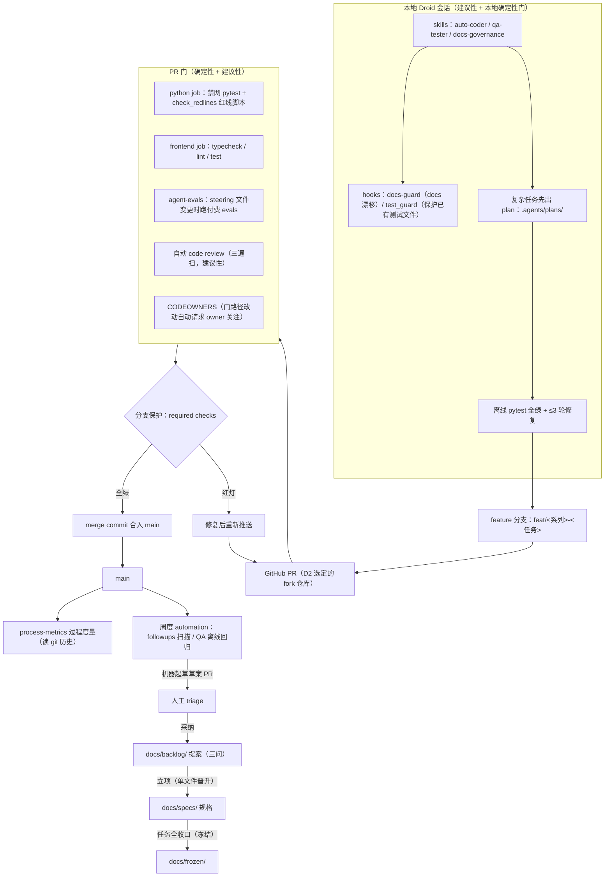
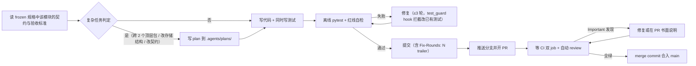
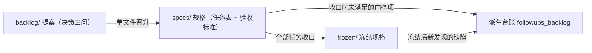

# AI-Native SDLC 参考手册

## 1. 文档目的

本文是 AI-Native SDLC（SD 系列）的**使用参考**：用流程图讲清这套「AI agent 为主编码者、确定性门兜底」的开发流程如何运转，并给出落地前需要准备的**工具清单**与**文档清单**。设计细节、任务排期与落地记录见权威来源 [AI_NATIVE_SDLC_SPEC.md](../specs/AI_NATIVE_SDLC_SPEC.md)；本文不重复规格内容，只做速查。

> **核心判断**（引自规格 §0）：skill 是建议性的，hook 和 CI 才是确定性的。建议性约束让违规变少，确定性门让违规接近不可能——前提是 CI 结果真的能阻止合并（分支保护），且门本身不能被 agent 顺手改掉。

## 2. 总体流程图

### 2.1 门禁架构全景

一个任务从本地会话到合入 main 的完整路径，以及 main 之后的回环：

### 2.2 单个任务的开发循环

auto-coder 驱动的一个任务从读规格到 PR 合入的循环（skill 文本与 PR 化纪律见规格 §3.6）：

### 2.3 规格文档的生命周期

流程升级本身也走同一套文档治理（单文件晋升，见 [MOC](../MOC.md) 命名与流转规范）：

## 3. 需要准备的工具

落地这套流程前，按下表逐项准备。右侧列为规格中对应的设计出处。

| 类别 | 工具 / 配置 | 用途 | 准备要点 |
|------|------------|------|----------|
| 代码托管 | GitHub 仓库（fork）+ Actions | CI 与自动化运行载体 | Actions 需启用；fork 内 PR 是同仓库 PR，Secrets 可用 |
| 代码托管 | 分支保护（branch protection） | 让 CI 红灯真正阻止合并 | `python` / `frontend` 设为 required checks；`enforce_admins` 按需开启；bot approval 不计入合并条件（review 保持建议性） |
| 代码托管 | `CODEOWNERS` | 门路径（workflow / hook / 红线脚本 / REVIEW.md / review skill）改动自动请求 owner 关注 | 唯一 owner 即作者时无法自审，该项降级为「可见」；引入独立 bot 账号后可恢复为强制 |
| CI | `.github/workflows/ci.yml` | Python + 前端双 job 确定性门 | CI 命令与 AGENTS.md 本地命令**逐字同源**；失败不自动重试 |
| CI | pytest-socket | 禁网测试（方案 a） | `NO_PROXY='*' pytest tests -q --disable-socket --allow-unix-socket --allow-hosts=127.0.0.1,localhost,::1`；放行 loopback（e2e_web 本机假后端需要） |
| CI | `scripts/check_redlines.py` | 红线静态检查（AST，不用 grep） | 主 venv 不 import sirchmunk、`llm_fallback` 锁 False、MCP stdout 纪律；白名单须带理由注释 |
| AI review | Factory Droid GitHub App + `droid-review.yml` / `droid.yml` | 每个 PR 自动拿到结构化 review | 仓库 Secret `FACTORY_API_KEY`；`gh` token 无 `workflow` scope，workflow 改动经 SSH 推送 |
| agent evals | `droid exec` + `agent-evals.yml` | steering 文件（skill / hook / AGENTS.md）变更时验证 agent 仍按纪律干活 | BYOK 模型配置 + `ZHIPU_API_KEY`（经 `apiKeyHelper` 读取，不进会话环境变量）；预算 = 用例数 × 3 次会话 + `timeout-minutes` + 账户额度三层兜底 |
| 本地 agent | Droid CLI（`droid exec`）+ 桌面 App | 会话内开发 + 定时 automation 的本机运行位置 | 桌面 App 需常驻运行；机器休眠错过运行会补跑一次，连续 10 天错过自动暂停 |
| 定时闭环 | Factory Automations × 2 | 每周 followups 扫描起草草案 PR、每周 QA 离线回归 | 注意 automation 会在共享工作树 `git checkout main`，运行时点前未提交的改动会致该 run 失败 |
| skill 分发 | `scripts/sync_skills.py` | 从 `.factory/skills/` 单一来源生成 `.claude/` / `.github/` 镜像 | 只改来源目录，手改镜像会被 `test_skill_mirrors.py` 拦下；改 skill 后必须运行同步 |
| 度量 | `scripts/measure_process.py` | 离线从 git 历史算 5 项过程指标 | 规格生命周期按文件路径推导，不按提交信息匹配 |

## 4. 需要准备的文档

| 文档 | 角色 | 位置 | 准备要点 |
|------|------|------|----------|
| `AGENTS.md` | agent 的行为契约（CLAUDE.md 对应物） | 仓库根 | 编码前必读纪律 + 关键纪律（离线测试、红线、双登记、stdout、提交流程）；改动会触发付费 evals，批量改一次 |
| frozen 规格 | 合规遍扫的判据来源（改某模块前先查其契约、验收标准与测试语义） | `docs/frozen/` | 已收口规格任务表不再新增任务；新功能走 backlog 立项 |
| 提案（三问） | intent 记录：解决什么问题 / 有没有更简单方案 / 如何确认有效 | `docs/backlog/<name>_backlog.md` | 机器起草的提案与人的同格式、同入口，不跳过三问 |
| 在途规格 | 任务排期与进度跟踪（任务表 + 验收标准列 + 测试方案 + In/Out of Scope） | `docs/specs/` | 结构由 `test_spec_structure.py` 机器校验；编号 ≥10 的冻结规格同样受约束 |
| `REVIEW.md` | review 三遍扫的人读版本（bugs / security / 合规） | 仓库根 | 与 `.factory/skills/review-guidelines/SKILL.md` 的 checklist 块逐字一致，由单测锁定；Important 必须修复或书面说明后才能合并 |
| QA 计划 / 对照表 / 进度 | 产品行为验收与 QA ↔ pytest 对照 | `.factory/skills/qa-tester/`（单一来源，不进镜像） | 失效用例及时标失效；QA 进度全仓只保留一份 |
| per-task plan | 复杂任务的实现审计记录 | `.agents/plans/<任务编号>.md` | 格式见该目录 README；随任务提交，不放 docs/（避免触发 MOC 登记） |
| evals 用例与基线 | agent steering 回归 | `evals/cases/`、`evals/baseline.json` | 活套件：每个修完的 agent 行为问题加一条回归用例；基线中通过的用例不得变失败 |
| 过程度量报告 | 领先 / 滞后指标基线与趋势 | `docs/analysis/process-metrics.md` | 1.0 只建基线，1.1 起为每个指标设目标值 |
| MOC | docs/ 索引与文档谱系 | `docs/MOC.md` | docs/ 增删文档后必须同步；docs-guard hook 每轮自动检查坏链与漏登记 |

## 5. 落地顺序（速查）

规格 §5.1 的落地顺序，含依赖理由：

1. **前置决策**（分支保护是否可用、Actions 跑在哪个仓库、CI 环境、存量提交如何进 main）——分支保护开启前必须完成存量合入，否则后续很麻烦；
2. **CI 门**：先在干净环境（全新 clone + 新 venv）复现离线基线并修掉差异，再写 workflow、开 required checks——不做这一步 CI 很可能一上来就红；
3. **review 回路**：核实自动 review 实际读取的指令文件位置，再写 REVIEW.md 与接入；
4. **skill 收敛**：镜像合并 + 同步脚本 + drift guard，必须先于 evals（镜像不一致时 eval 结果没有意义）；
5. **QA 对照补测**、**过程度量基线**——趋势指标需要时间积累，尽早出基线；
6. **agent evals**（门控：先测单次成本、确认预算）；
7. **定时 automation**（门控：先核实运行位置；阈值部分需 CI 跑满约 4 周数据）；
8. **收口回归与回写**：全量离线全绿、计数核对、文档回写、冻结入 `frozen/`。

## 6. 门控与验收要点

- **每条纪律都要回答「谁兜底」**：skill 文本（建议性）→ 本地 hook（本地确定性）→ CI（强制确定性）三层递进，缺哪层就在规格里写明降级与恢复条件（如 CODEOWNERS 因无法自审降级为「可见」）。
- **确定性门必须实证**：不是「配好了」，而是用故意违规的 PR 证明红灯真的能阻止合并（如 `import sirchmunk`、单测发真实 HTTP 请求的演练 PR）。
- **门不能被 agent 改掉**：workflow、hook、红线脚本、review 指令等路径纳入 CODEOWNERS 与 review Important 项；evals 判据③专门抓「删除或弱化已有测试断言」。
- **付费与噪声控制**：evals 只在 steering 路径变更时触发；机器产出一律先开草案 PR 经人 triage，不自动合入。
- **验收看可验证标准**：每个任务在规格任务表有可机器或可观察的验收标准（拦截实证、CI 全绿计数、drift guard 通过），不凭感觉收口。

## 7. 参考

- 权威规格与全部落地记录：[../specs/AI_NATIVE_SDLC_SPEC.md](../specs/AI_NATIVE_SDLC_SPEC.md)
- 外部方法论起源：Anthropic [The AI-native SDLC playbook](https://claude.com/resources/articles/the-ai-native-sdlc-playbook)
- CI 部分承接的提案存档：[../frozen/ci-pipeline_backlog_frozen.md](../frozen/ci-pipeline_backlog_frozen.md)
- 文档治理与流转规则：[../MOC.md](../MOC.md)
- 过程度量基线：[../analysis/process-metrics.md](../analysis/process-metrics.md)
