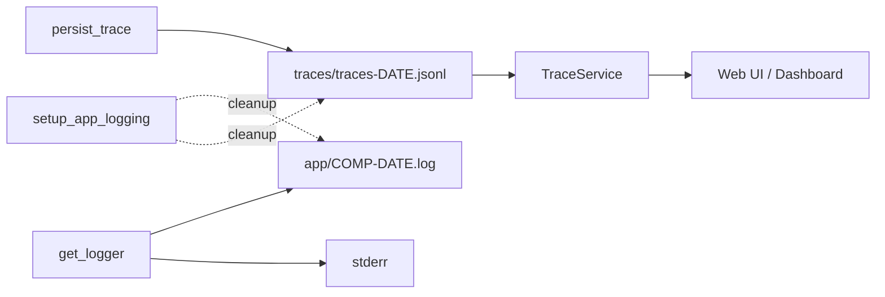

<!-- 扩展规格：日志分层与按日切分（Trace 日志按日落盘 / 应用运行日志落盘 / 保留期清理 / 测试隔离 / 历史迁移）。格式与章节对齐 INGESTION_ROBUSTNESS_SPEC_frozen.md；基线为「DEV_SPEC A–I + S / SX / IR / WC 系列均已收口冻结」状态。 -->

# 日志分层与按日切分规格 (LOGGING_SPEC)

> 版本：0.1 — 立项（2026-10-17），现状审计 + 模块设计 + 项目排期
>
> 起源：会话内对 `logs/traces.jsonl` 的体量审计（见 1.2），经用户确认四项决策（见 2.3）后立项；未经 backlog 草案阶段，决策依据直接记录在本规格第 1、2 章。
>
> 基线：DEV_SPEC_frozen.md 阶段 F1/F2（TraceContext + JSON Lines 落盘）、G5（TraceService）；WEBUI_CHAT_SPEC_frozen.md（Web UI 追踪页经 API 读同一 TraceService）。
>
> 审计日期：2026-10-17（file 引用基于 `feat/sirchmunk-agentic-search` 分支）

## 目录

- 项目概述
- 核心目标与范围
- 技术选型与模块设计
- 注意事项（源码实证）
- 测试方案
- 配置变更汇总
- 项目排期
- 优点亮点与风险应对
- 参考

---

## 1. 项目概述

### 1.1 结论速览

日志拆成两层，均按**本地日期**切分落盘、默认保留 30 天：

| 层 | 记录内容 | 位置 | 读取方 |
|---|---|---|---|
| Trace 日志 | 每次查询（default / agentic / chat）与每次摄取的分阶段耗时、method、provider、结果摘要 | `logs/traces/traces-YYYY-MM-DD.jsonl`（JSON Lines） | Web UI / Streamlit 追踪页（TraceService）、评估 |
| 应用运行日志 | 进程启动、WARNING / ERROR、降级与重试、异常堆栈、uvicorn 服务日志 | `logs/app/<component>-YYYY-MM-DD.log`（文本行，与 stderr 同格式） | 人工排障 |

聊天会话、摄取历史、任务状态在 SQLite 中，属业务数据，不属于日志，不在本规格范围。

### 1.2 现状审计（2026-10-17 实测）

| # | 问题 | 证据 |
|---|---|---|
| L1 | **测试污染真实日志** | `logs/traces.jsonl` 16,562 行 / 45MB；ingestion 14,759 条中 13,941 条 `source_path` 位于 pytest 临时目录，476 条来自 `tests/fixtures`，334 条 metadata 为空（早期测试产物）。约 87% 是测试数据。成因：大量测试在 tmp 写不含 `observability` 段的 `settings.yaml`，默认值 `./logs/traces.jsonl` 相对 cwd（仓库根）解析。 |
| L2 | 单文件全量重解析 | `TraceService._load` 以整个文件 `(mtime, size)` 为缓存键，任何一次新 trace 写入都使下次列表请求全量重解析；当前冷加载 0.45s，随文件线性增长，全部记录常驻内存，而 Web UI 一次最多展示 500 条。 |
| L3 | 运行日志不落盘 | `observability.logger.get_logger` 只挂 stderr handler；进程退出后 WARNING / ERROR 丢失。`logs/*.log` 均为手动重定向产物。 |
| L4 | 配置项未生效 | `observability.logging.log_level` 被解析但无人读取（`observability.enabled` / `detail_level` / `dashboard.traces_dir` 同样未接线）。 |
| L5 | 遗留写入路径 | `TraceCollector` / `write_trace` / `get_trace_logger` 在生产代码中无调用方，实际写入只走 `core.trace.persist.persist_trace`。 |

---

## 2. 核心目标与范围

### 2.1 目标

1. **G1 测试隔离**：全量离线测试不再写入仓库 `logs/`（修复 L1）。
2. **G2 Trace 按日切分**：trace 写入 `logs/traces/traces-YYYY-MM-DD.jsonl`；读取端按文件缓存，历史文件不重解析（修复 L2）。
3. **G3 应用日志落盘**：进程入口挂按日文件 handler，`log_level` 生效（修复 L3、L4 中的 log_level）。
4. **G4 保留期**：`retention_days` 默认 30，过期文件自动清理。
5. **G5 历史迁移**：现有 `logs/traces.jsonl` 按日拆分迁移，剔除测试记录，原文件改名备份。

### 2.2 不在范围

- `observability.enabled` / `detail_level` / `dashboard.traces_dir` 接线（保持现状：解析但不消费）。
- 遗留 `TraceCollector` / `write_trace` / `get_trace_logger`（F2 契约与单测保留不动）。
- Sirchmunk sidecar 日志规范化（独立进程，启动脚本重定向方式不变）。
- 日志集中采集、结构化应用日志（JSON）、多实例共享存储。

### 2.3 已确认决策

| 决策 | 结论 |
|---|---|
| D1 分层范围 | Trace + 应用运行日志落盘；sidecar 不动 |
| D2 保留期 | 默认 30 天，可配置；`0` 表示永不清理 |
| D3 历史文件 | 按日拆分迁移，剔除测试记录；原文件改名 `traces.jsonl.migrated` 备份 |
| D4 治理 | 本规格（LG 系列）立项后实现 |

---

## 3. 技术选型与模块设计

### 3.1 路径语义（兼容既有调用）

`observability.log_file` 的取值决定 trace 写入形态：

- 以 `.jsonl` 结尾 → **单文件模式**（旧语义，测试大量传入 tmp 文件，行为不变）。
- 其他值 → **目录模式**，按日写 `<dir>/traces-YYYY-MM-DD.jsonl`。

默认值由 `./logs/traces.jsonl` 改为 `./logs/traces`。`persist_trace(trace, log_file=...)` 与 `TraceService(traces_path)` 签名不变，两种形态都支持。

**相对路径解析**：日志相关的相对路径（`log_file`、`app_log_dir`）若设置了环境变量 `RAG_LOG_ROOT`，相对它解析；否则相对 cwd（旧行为）。绝对路径原样使用。

### 3.2 模块：`observability/log_files.py`（新增）

纯函数 + 小工具，无全局副作用：

- `LOG_ROOT_ENV = "RAG_LOG_ROOT"`；`resolve_log_path(path) -> Path`。
- `is_single_file(path) -> bool`（后缀 `.jsonl`）。
- `daily_path(directory, prefix, suffix, day) -> Path`：`<prefix>-<YYYY-MM-DD><suffix>`。
- `local_today() -> date`：本地日期（`started_at` 仍为 UTC ISO 字符串，文件名用本地日期便于人工查看）。
- `cleanup_expired(directory, prefix, suffix, retention_days, today) -> list[Path]`：删除文件名日期早于 `today - retention_days` 的文件；只匹配严格的 `<prefix>-YYYY-MM-DD<suffix>` 文件名，不碰其他文件；单个删除失败跳过。

### 3.3 Trace 写入：`core/trace/persist.py`

`persist_trace` 解析目标路径：单文件模式直接追加；目录模式追加到当天文件。每条记录一次 `open("a")` + 单行写入，不做重命名，多进程（API / MCP / CLI）并发追加安全。写入失败仍只记 warning（旁路语义不变）。

### 3.4 Trace 读取：`TraceService`

- 单文件模式：行为不变。
- 目录模式：读取 `traces-*.jsonl` 全部文件，**按文件**以 `(mtime_ns, size)` 缓存；历史文件不变即不重解析，只有当天文件随写入失效。目录中消失的文件从缓存移除。
- 保留期把文件数限制在约 30 个，故不做"凑够条数即停"的分页加载（API 的 `limit/offset` 语义不变）。

### 3.5 应用运行日志：`observability/logger.py`

新增 `setup_app_logging(settings, component) -> Path | None`，**只在进程入口调用**：

- root logger 级别取 `observability.logging.log_level`（非法值 fail-fast，见第 6 章）。
- 在既有 stderr handler 之外挂 `DailyFileHandler`：写 `<app_log_dir>/<component>-YYYY-MM-DD.log`，格式与 stderr 相同；每次 emit 检查日期，跨天时切换文件。幂等：重复调用替换旧 handler。
- 过滤 `uvicorn.access` 记录（访问日志只走 stderr，不落盘）。
- 库代码里的 `get_logger` 不变：未调用 setup 的进程（含全部单元测试）不产生日志文件。

入口接线：

| component | 入口 | 方式 |
|---|---|---|
| `api` | `scripts/start_api.py::main` | 配置解析成功后调用；`uvicorn.run(..., log_config=None)` 让 uvicorn 日志传播到 root |
| `mcp` | `mcp_server.server.main` | 加载配置成功时调用，失败静默跳过（维持无配置可启动的契约）；stdout 纪律不受影响 |
| `ingest` / `query` / `evaluate` | 各脚本 `__main__` 块 | `setup_cli_logging(component, argv, default_config)`：仅解析 `--config`，加载失败静默跳过（错误由 `main` 照常报告） |

### 3.6 保留期清理

`retention_days`（默认 30，`0` = 不清理）。清理时机：`setup_app_logging` 调用时一次 + `DailyFileHandler` 跨天切换时一次；范围是 `app_log_dir` 下本组件的日志文件，以及目录模式下的 trace 目录。未调用 setup 的进程从不删除文件。

### 3.7 历史迁移：`scripts/migrate_traces.py`

- 输入 `--src`（默认 `logs/traces.jsonl`）、`--dest`（默认 `logs/traces`）、`--dry-run`、`--keep-test-records`。
- 按 `started_at` 转本地日期分桶写入 `traces-YYYY-MM-DD.jsonl`；目标文件已存在时追加，并跳过已存在的 `trace_id`（可重复执行）。
- 测试记录判定（仅 ingestion）：`metadata.source_path` 为空，或位于系统临时目录 / `/tmp/` / `/var/folders/` / 含 `pytest-of-` / 含 `tests/fixtures`。query 记录无可靠来源标识，全部保留。（实现时补充了一条 query 判定，见 7.1。）
- 非 dry-run 时原文件改名为 `<src>.migrated`，不删除。输出各类计数。



图中 COMP 为 component（api / mcp / ingest / query / evaluate），DATE 为本地日期。

---

## 4. 注意事项（源码实证）

- `TimedRotatingFileHandler` 通过重命名轮转，多进程同写一个文件时会互相覆盖；本规格改为"按日期拼文件名 + 追加"，不重命名。
- uvicorn 默认 `LOGGING_CONFIG` 会对 `uvicorn` logger 做 dictConfig 并设 `propagate=False`，入口提前挂的 handler 会被清掉；因此 `start_api.py` 传 `log_config=None`，uvicorn 日志改由 root 的 stderr + 文件 handler 输出。
- `tests/e2e/test_mcp_client.py` 子进程 `cwd=tmp_path` 且配置 `log_file: ./logs/traces.jsonl`；设置 `RAG_LOG_ROOT` 后子进程继承环境变量，trace 落到会话临时根，测试不断言该文件，行为不受影响。
- `api/deps.py::storage_health` 检查 `Path(log_file).parent.exists()`：目录模式下 `./logs/traces` 的父目录即 `./logs`，表达式语义不变，只需改为对解析后的路径求值。
- `setup_app_logging` 会修改 root logger 的级别与 handler；`tests/conftest.py` 以 function 级 autouse fixture 快照并恢复 root logger 状态，避免跨用例泄漏。

---

## 5. 测试方案

全部离线、确定性（日期经参数注入，不依赖真实时钟）。

| 对象 | 用例 |
|---|---|
| 测试隔离 | `tests/conftest.py` session 级 autouse fixture 设置 `RAG_LOG_ROOT`；回归：默认配置下 `persist_trace` 写入 `RAG_LOG_ROOT` 而非 cwd；全量测试前后仓库 `logs/` 快照不变（人工核对，记入收口记录） |
| `log_files` | 相对 / 绝对路径解析、env 未设回落 cwd；`daily_path` 命名；`cleanup_expired` 边界（恰好 N 天保留、N+1 天删除、`0` 不删、不匹配的文件不碰、删除失败不抛） |
| `persist_trace` | 单文件模式回归（既有用例）；目录模式写当天文件、跨日写不同文件 |
| `TraceService` | 目录模式合并多日文件且按 `started_at` 倒序；历史文件不重解析（解析计数）；删除文件后缓存移除；单文件模式回归（既有用例） |
| settings | 默认值（`./logs/traces`、`./logs/app`、30）；`retention_days` 非负整数校验、`log_level` 枚举校验（非法值 `ConfigError`） |
| 应用日志 | `setup_app_logging` 写当天文件、级别生效、幂等不重复挂 handler、`uvicorn.access` 不落盘、跨天切换文件并触发清理；`start_api` 入口 `log_config=None` |
| 迁移脚本 | 合成 JSONL：按本地日期分桶、测试记录剔除计数、`--keep-test-records`、dry-run 不写盘、重复执行按 `trace_id` 去重、原文件改名备份 |

---

## 6. 配置变更汇总

```yaml
observability:
  enabled: true
  log_file: ./logs/traces      # 目录 = 按日切分；以 .jsonl 结尾 = 单文件（兼容旧语义）
  app_log_dir: ./logs/app      # 应用运行日志目录（仅进程入口启用）
  retention_days: 30           # 按日文件保留天数；0 = 不清理
  logging:
    log_level: INFO            # DEBUG | INFO | WARNING | ERROR | CRITICAL
  detail_level: standard
```

- `ObservabilityConfig` 新增 `app_log_dir: str = "./logs/app"`、`retention_days: int = 30`；`log_file` 默认改为 `./logs/traces`。
- 校验：`retention_days` 为非负整数（拒绝 bool）；`log_level` 大小写不敏感，归一为大写，不在枚举内即 `ConfigError`。
- 环境变量 `RAG_LOG_ROOT`：相对日志路径的解析根（测试与临时运行使用）。

---

## 7. 项目排期

> **任务前缀 LG（Logging）**，避免与既有 A–I / S / SX / IR / WC / V 编号冲突。每个任务单独提交。

### 📊 进度跟踪表 (Progress Tracking)

> **状态说明**：`[ ]` 未开始 | `[~]` 进行中 | `[x]` 已完成

| 任务编号 | 任务名称 | 状态 | 完成日期 | 验收标准 |
|---------|---------|------|---------|---------|
| LG0 | 规格立项 | [x] | 2026-10-17 | 本文档；MOC / README / AGENTS 同步登记 |
| LG1 | 测试隔离 | [x] | 2026-10-17 | `RAG_LOG_ROOT` 解析 + conftest fixture + 回归用例；全量测试后仓库 `logs/` 无新增写入（`c162925`） |
| LG2 | Trace 按日写入 + 配置 | [x] | 2026-10-17 | `log_files` 模块；`persist_trace` 目录模式；settings 默认值与校验；`config/settings.yaml` 同步（`5104cc9`，与 LG3 合并提交） |
| LG3 | TraceService 目录模式 | [x] | 2026-10-17 | 按文件缓存；多日合并；API 健康检查对解析后路径求值；既有追踪页 / API 用例零回归（`5104cc9`） |
| LG4 | 应用运行日志 | [x] | 2026-10-17 | `setup_app_logging` + `DailyFileHandler`；五个入口接线；`log_level` 生效；uvicorn 日志落盘（`301b8d4`） |
| LG5 | 保留期清理 | [x] | 2026-10-17 | `cleanup_expired` + 跨天触发；边界单测（`542d353`，先于 LG4 实施） |
| LG6 | 历史迁移 | [x] | 2026-10-17 | `scripts/migrate_traces.py` + 单测；对真实文件先 dry-run，经用户确认后执行（脚本 `4fcfd98`；已正式执行，见 7.1） |
| LG7 | 文档收口 | [x] | 2026-10-17 | USAGE_GUIDE 日志章节；全量离线测试全绿并记录计数；本规格进度表与实现偏差更新（`ae8fb29`；2451 passed / 11 skipped） |

### 7.1 实现偏差与收口记录

- **LG2 + LG3 合并提交**：默认 `log_file` 改为目录后，若 TraceService 未同时支持目录模式，中间提交会让 Web UI 读不到 trace，因此两者同一提交落地。
- **LG5 先于 LG4**：`DailyFileHandler` 开新文件时调用 `cleanup_expired`，先交付清理函数。
- **遗留 `get_trace_logger` 修正**（LG7）：原实现把 `log_file` 当文件打开，目录默认值下会失败；改为经 `trace_target` 解析到当天文件。该接口仍为遗留路径，生产写入走 `core.trace.persist`。
- **迁移判定补充**（LG6）：除 3.7 的 ingestion 规则外，`trace_type=query` 但无 `metadata.query` 且首阶段为 `integrity` 的记录也按测试记录剔除（测试向 pipeline 注入默认 query 类型 trace 所致，真实查询不会出现）；同一源文件内重复的 `trace_id` 只保留首条（计 `duplicates`）。
- **真实文件 dry-run**（`logs/traces.jsonl`，45 MB）：total=16562、kept=595、dropped_test=15767、invalid=0、duplicates=200、already_present=0；保留记录分布在 8-18、10-05、10-06、10-07、10-13、10-14、10-15 七天。经用户确认后正式执行，结果与 dry-run 一致：生成 7 个日文件共 595 行（约 0.5 MB），原文件保留为 `logs/traces.jsonl.migrated`；TraceService 读取全部 595 条耗时约 5 ms（迁移前冷加载 45 MB 约 0.45 s）。`traces-2026-08-18.jsonl` 已超出 30 天保留期，下次进程入口启动时会被清理（原始记录仍在 `.migrated` 备份中）。
- **测试隔离核验**：LG1 起每次全量测试前后对仓库 `logs/` 做文件快照比对，均无变化。最终计数 2451 passed / 11 skipped（AGENTS.md 中 2403 为立项前基线）。

---

## 8. 优点亮点与风险应对

| 风险 | 应对 |
|---|---|
| 旧配置 / 测试依赖单文件路径 | `.jsonl` 后缀保留单文件模式，签名不变 |
| 多进程并发写同一日文件 | 单行追加写，不重命名、不持有长期文件锁 |
| 清理误删 | 只匹配严格日期文件名；只在显式调用 setup 的进程中执行；`0` 关闭 |
| 迁移误删真实记录 | dry-run 先行；只剔除 ingestion 的临时 / fixture 路径记录；原文件保留为 `.migrated` |
| root logger 状态泄漏到其他测试 | conftest 快照恢复 |

---

## 9. 参考

- [DEV_SPEC_frozen.md](../frozen/DEV_SPEC_frozen.md)：F1 TraceContext、F2 JSON Lines logger、G5 TraceService。
- [WEBUI_CHAT_SPEC_frozen.md](../frozen/WEBUI_CHAT_SPEC_frozen.md)：Web UI 追踪页、chat trace 每轮一条的契约。
- [STORAGE_SCALING_ANALYSIS.md](../analysis/STORAGE_SCALING_ANALYSIS.md)：`logs/traces.jsonl` 在存储清单中的定位。
